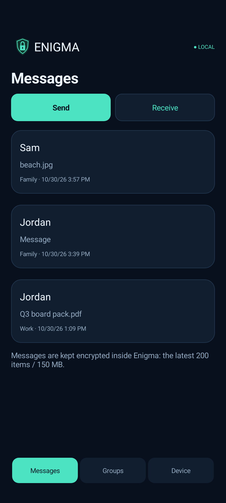
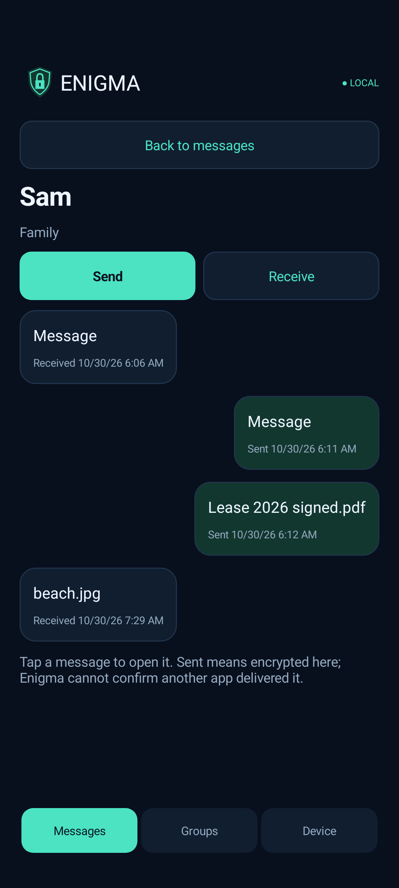
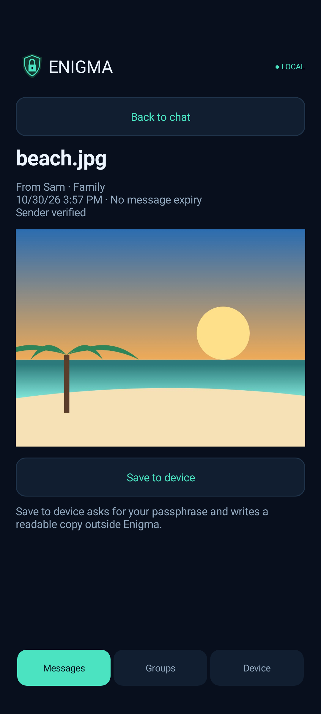
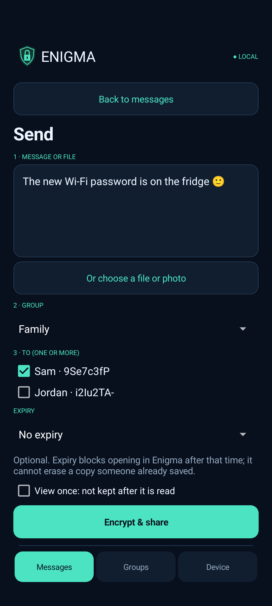
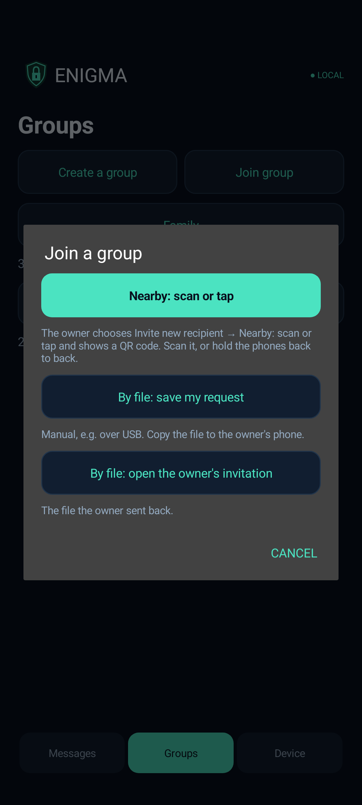
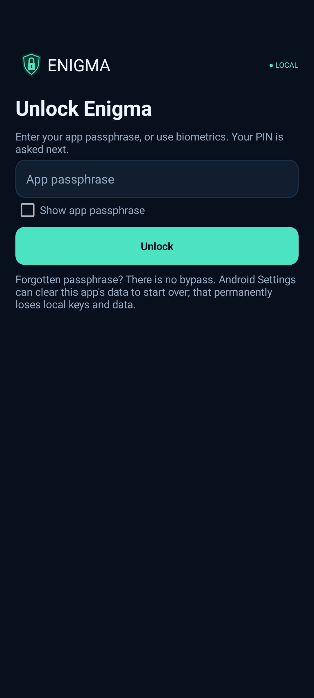

# Enigma — private messages over the apps you already use

Enigma is an Android app that gives you and the people you trust **your own encryption keys**, so you can send sensitive messages, photos and files over **WhatsApp, email, SMS/Messages, Signal, Telegram, a USB stick — anything** without that app, your email provider or anyone in between being able to read them.

You write the message in Enigma, and it becomes a small encrypted `.enigma` file (or a block of encrypted text) that only the person you chose can open. Send it however you like. On their phone they tap the file, choose Enigma, and read it there.

- **Your keys, made on your phone.** Each phone creates its own private key in the Android Keystore (hardware-backed where the phone supports it). Group secrets are generated from live camera noise mixed with secure system randomness. No account, no server, no phone number.
- **Works over any channel.** Enigma doesn't send anything itself. The messenger or email only ever carries ciphertext.
- **Only the chosen person can open it.** Every message is encrypted for one recipient and signed by the sender, so the reader knows who it really came from and that nothing was changed.
- **Join in person.** People join a group by scanning a QR code or tapping phones (NFC) while they're together. Keys travel over a short-lived private Wi-Fi link with an extra layer of encryption and a six-digit check code. A manual file route (for example over USB) also works.
- **Read inside the app.** Received photos and text open inside Enigma. Nothing readable is saved to the phone unless you choose **Save to device** (which asks for your passphrase).
- **Locked by default.** A passphrase (or fingerprint) protects everything. Enigma locks whenever you leave it and blocks screenshots.

> **Status:** a development prototype that has **not been independently security-audited**. Don't rely on it for life-or-death secrets. See [SECURITY.md](SECURITY.md) for exactly what it does and doesn't protect against, and [SYSTEM_DESIGN.md](SYSTEM_DESIGN.md) for how it works.

## Screenshots

| Conversations | A conversation | A received photo |
|---|---|---|
|  |  |  |

| Send: message, group, person | Join a group in person | Locked by default |
|---|---|---|
|  |  |  |

*These show demo people and messages on an emulator. The messages are really encrypted, created by `ScreenshotTest`. Enigma blocks normal screenshots, so these are rendered from inside the app.*

## How it works, in short

1. **Set up:** choose a passphrase, name your phone, and move the camera for five seconds to create your first group's secret.
2. **Invite:** the group owner taps **Invite new recipient → Nearby: scan or tap**; the other person taps **Join group → Nearby: scan or tap** and scans the QR code (or holds the phones together). Both screens show the same six-digit code; both confirm.
3. **Send:** **Messages → Send** → type or pick a file → group → person → **Encrypt & share**, then pick WhatsApp, email or any app.
4. **Receive:** tap the `.enigma` file in that app and choose **Enigma** (or **Messages → Receive**).

## Download 0.6.0

**[Download Enigma.apk from main](https://github.com/Tersy89/QuietKey/blob/main/Enigma.apk)**. Open it and choose **Download raw**. Install it on both devices. It appears as **Enigma (test)**. This is an unaudited development prototype with no recovery; use disposable data while testing.

The app ID and debug signer are unchanged. Install over the existing test app if you want to retain its data. Older development formats are not a compatibility commitment. Update both devices to **0.6.0**: Messages is now a chat list with **Send** and **Receive**; typed messages travel as small `.enigma` files by default; received photos and text open inside the app. Joining uses one QR code or an NFC tap, or manual file transfer. QKD3 text and file-v3 remain the current message formats.

**New to Enigma? Read the [user guide](https://htmlpreview.github.io/?https://github.com/Tersy89/QuietKey/blob/main/docs/user-guide.html) ([source](docs/user-guide.html))** for step-by-step instructions with screenshots and a plain-language summary of how the security works.

## Protect and set up your device

1. Choose and repeat an app passphrase of 12–128 characters. Use **Show passphrase** to check typing; it starts hidden each time. Several random words are preferable. This cryptographically protects the local vault, including group secrets, groups and history. There is no forgotten-passphrase recovery.
2. Name the device and complete live camera setup: at least five seconds and 60 frames. Android Keystore generates the private RSA identity; camera input contributes additional input to group-secret generation. No video or audio is saved. The initial **Starter group** contains only this device.
3. **Device → Security & unlock** provides **Lock Enigma now**, passphrase change, and optional fingerprint unlock on supported Android 8+ devices with strong enrolled biometrics. From 0.7.0, unlocking takes your passphrase or fingerprint and then a 4-digit PIN. Five wrong PINs, or the panic PIN (9999 until you change it), erase Enigma's keys and data. Changing the passphrase disables biometric unlock. If an existing biometric setup fails after this update, unlock with your passphrase, then disable and enable biometric unlock again.

The protected vault is the app's local storage, not a separate personal file-storage feature. Leaving the app locks it; screen-off always locks. Camera setup and system file pickers have a controlled allowance of at most two minutes; scanning the owner's joining code allows at most five minutes and Android's Wi-Fi connection prompt 90 seconds. Active nearby transfers close when the app locks, closes or leaves the foreground outside those handoffs. Screen-off still locks immediately. Fresh passphrase entry is required before readable-file export, reset and security-setting changes.

## Join a group

Only the owner creates the group. On that phone open **Groups → group → Invite new recipient**. On the other phone choose **Groups → Join group**. Joining copies the group's secret, settings and member public keys to the new phone, encrypted so only that phone can open them. It is separate from message encryption.

### Nearby: one QR code or an NFC tap (recommended)

1. Owner: choose **Nearby: scan or tap**. Allow the permission Android asks for the first time (Nearby devices on Android 13+, Location on older phones, with Location turned on). Enigma starts its own private hotspot with no Internet and shows one code. No trip to Settings is needed.
2. Recipient: **Join group → Nearby: scan or tap**, then tap **Scan QR code**, or hold the phones back to back with NFC on (keep both screens on until the check code appears). Tap **Connect** if Android asks to connect to the owner's device.
3. Both phones show a six-digit **check code**. Owner: tap **Codes match · Invite** only if both codes are the same. Recipient: check the code and tap **Join group**. A signed confirmation returns automatically and both screens show success.

The code works once and expires after five minutes. Only show it to the person joining. Keep both apps open; Cancel, background or screen-off stops joining. The owner's phone may drop its normal Wi-Fi while the joining hotspot runs and reconnects afterwards. If both phones are already on the same private Wi-Fi, the owner can choose **Nearby on the same Wi-Fi** instead.

### Manual transfer (USB cable or any file copy)

1. Recipient: **Join group → By file: save my request**. Copy the file to the owner's phone, for example through a computer over USB cables, or use **Copy text**.
2. Owner: **Invite new recipient → By file: open their request**, check the device and tap **Invite**, then **Save file** for the invitation and copy it back.
3. Recipient: **Join group → By file: open the owner's invitation**. Compare the six-digit check code with the owner in person or on a call, then tap **Codes match · Join**. Optionally save a confirmation file for the owner (**By file: open their confirmation**); the first verified message also confirms joining.

The files contain only a public request, an invitation encrypted for the recipient's phone, and a signed confirmation, so any transport is fine. Request files expire five minutes after they are made.

Private identity keys never leave the phone. Names and self-signed keys alone do not prove a real-world identity; pair with the known person's device and compare check codes.

The owner repeats this for each new device, up to 30 per group. Existing members receive owner-signed directory updates with new messages/files. Offline devices update when a packet reaches them. A device identity can join multiple groups, each with an independent secret.

## Messages: send and receive

Three tabs: **Messages**, **Groups** and **Device**. Messages lists your conversations (one per person per group), newest first, with **Send** and **Receive** at the top and inside each conversation.

**Send:** type a message *or* choose a file/photo → choose the group → choose the person → **Encrypt & share**. Enigma makes a `.enigma` file that only that person can open and opens Android's share sheet, so you can send it with WhatsApp, email or anything else, or later save it for a USB copy (open the item → **Save .enigma file (for USB)**). **Send as text instead** makes a block of encrypted text to paste into a chat. Expiry is optional and defaults to none. Sharing leaves Enigma, so it locks; unlock to continue.

**Receive:** tap the `.enigma` file in your messenger or file manager and choose **Enigma**, or use **Messages → Receive → Open .enigma file**. Enigma works out the group from the file, checks the sender's signature and opens it: photos and text are shown inside the app; other file types show their name and size. **Save to device** asks for your passphrase and writes a readable copy where you choose. Pasted encrypted text works too (**Receive → Open pasted text**). Nothing readable is written to storage unless you save it.

New packets combine a fresh secret wrapped to the sender/recipient public keys with the group's secret to derive their content key. Reception needs both the endpoint private key and the correct group secret. Another member's private key plus the shared group secret cannot open A↔B private content. Signatures authenticate the sender; encryption provides confidentiality. Missing, self or unregistered recipients are rejected by both UI and protocol.

History keeps the latest 200 encrypted entries and up to 150 MiB of encrypted file packages. Text/history metadata and group secrets are inside the encrypted vault. File packages remain encrypted in private storage. Plaintext message/file bodies are not persisted in history. Original and saved files remain at the locations you choose.

## Expiry

Choose **Expiry** before encryption: **No expiry** by default, five minutes, one hour, 24 hours, seven days or 30 days. It starts at encryption, is signed/authenticated, and is capped by group expiry. Enigma checks expiry on opening, reopening from a conversation and saving. An open message closes when it expires. Group expiry is a separate ten-year policy.

Expiry uses device clocks. It cannot erase saved plaintext or prevent a modified recipient from bypassing expiry. It is not remote self-destruction.

External repeated opening of the same pasted text is rejected after its ID is durably saved; reopening it from the conversation remains possible before expiry. Files can be reopened before expiry. Files up to 50 MiB are supported; names and MIME types are encrypted.

## Removal and reset

Removing local trust blocks that identity here but cannot revoke secrets already held elsewhere. Create a fresh group and invite remaining members for group replacement. Automatic rekeying and forward secrecy are not implemented. See [SECURITY.md](SECURITY.md) for limits.

**Device → Reset app & delete local data** requires the current passphrase and exact typed **RESET**. Android clears this installation's keys, groups, setup, history/cache, permissions and URI grants, then closes the app. The APK stays installed. Files outside the app remain. To start over after forgetting the passphrase, clear app data in Android Settings; this destroys the local identity/data.

## Build and test

JDK 17, SDK Platform 35, Build Tools 34.0.0, checksum-pinned Gradle 8.9 wrapper and AGP 8.7.3. This PC's SDK/tools are configured in ignored local files.

```powershell
.\tools\dev.ps1 build
.\tools\dev.ps1 protocol
.\tools\dev.ps1 devices
.\tools\dev.ps1 install -Serial YOUR_PHONE_SERIAL
.\tools\dev.ps1 device-tests -Serial YOUR_PHONE_SERIAL
```

Debug output: app/build/outputs/apk/debug/app-debug.apk; app ID app.quietkey.debug. Keep the same signing key for updates. Use the preserving device-tests helper on a phone: Gradle connected tests uninstall the app afterward.

[SYSTEM_DESIGN.md](SYSTEM_DESIGN.md) is the living implemented design, maintained with architecture/security/workflow changes under [AGENTS.md](AGENTS.md). [TESTING.md](TESTING.md) contains phone steps; [VERIFICATION.txt](VERIFICATION.txt) records actual evidence and remaining checks.

## Licence

[MIT](LICENSE) © 2026 Tersy89. Third-party libraries (ZXing, AndroidX, Bouncy Castle) keep their own licences.
