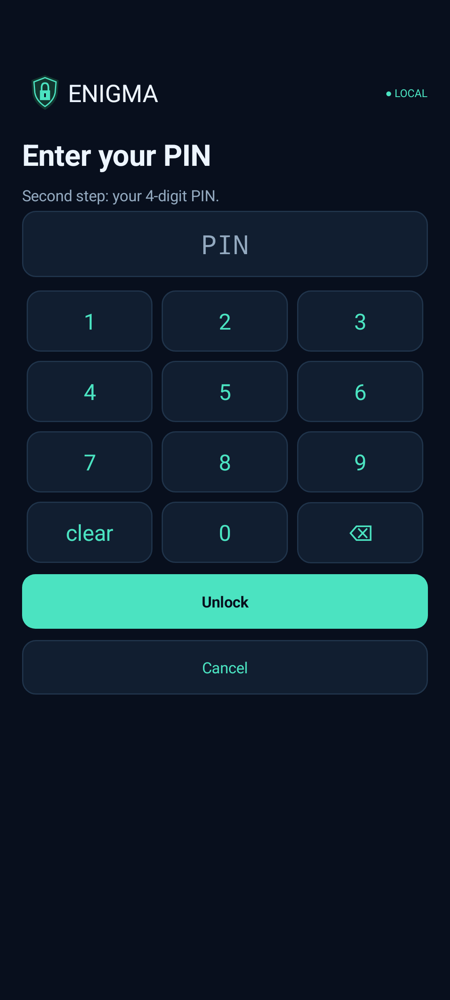

# Enigma — private messages over the apps you already use

Enigma is an Android app that gives you and the people you trust **your own encryption keys**, so you can send sensitive messages, photos and files over **WhatsApp, email, SMS/Messages, Signal, Telegram, a USB stick — anything** without that app, your email provider or anyone in between being able to read them.

You write the message in Enigma, and it becomes a small encrypted `.enigma` file (or a block of encrypted text) that only the people you chose can open. Send it however you like. On their phone they tap the file, choose Enigma, and read it there.

**Version 1.0.0.** [Download](#download) · **[User guide](https://htmlpreview.github.io/?https://github.com/Tersy89/QuietKey/blob/main/docs/user-guide.html)** ([source](docs/user-guide.html)) · **[Security overview](https://htmlpreview.github.io/?https://github.com/Tersy89/QuietKey/blob/main/docs/security.html)** (illustrated) · [How the security works](#how-the-security-works)

- **Your keys, made on your phone.** Each phone makes its own keys, mixing the system's secure randomness with live camera and motion-sensor input. No account, no server, no phone number.
- **Two families of cryptography at once.** Every key agreement is X25519 **plus** ML-KEM-768 (post-quantum), and every signature is Ed25519 **plus** ML-DSA-65. An attacker would have to break both families.
- **A fresh key for every message.** Each message uses a one-time key whose private half is deleted once the message is opened, so old messages stay safe even if your phone is stolen later.
- **Works over any channel.** Enigma doesn't send anything itself. The messenger or email only ever carries ciphertext.
- **Send to one person or several.** Every recipient is signed into the message, so a message can't be re-addressed to someone else.
- **Join in person.** People join a group by scanning a QR code or tapping phones (NFC) while they're together. Keys travel over a short-lived private Wi-Fi link with an extra layer of encryption and a six-digit check code. A manual file route (for example over USB) also works.
- **Two-step unlock with a self-destruct.** Passphrase or fingerprint, then a 4-digit PIN typed on Enigma's own number pad. Five wrong PINs, or a panic PIN you choose (9999 until you change it), erase Enigma's keys and data.
- **Read inside the app.** Received photos and text open inside Enigma. Nothing readable is saved to the phone unless you choose **Save to device**, which asks for your passphrase. Enigma locks whenever you leave it and blocks screenshots.

> **Status:** a development prototype that has **not been independently security-audited**. Don't rely on it for life-or-death secrets. See [SECURITY.md](SECURITY.md) for exactly what it does and doesn't protect against, and [SYSTEM_DESIGN.md](SYSTEM_DESIGN.md) for how it works.

## Screenshots

| Conversations | A conversation | A received photo |
|---|---|---|
|  |  |  |

| Send: message, group, people | Join a group in person | Second step: PIN on Enigma's own pad |
|---|---|---|
|  |  |  |

*These show demo people and messages on an emulator. The messages are really encrypted, created by `ScreenshotTest`. Enigma blocks normal screenshots, so these are rendered from inside the app.*

## Download

**[Download Enigma.apk (1.0.0) from main](https://github.com/Tersy89/QuietKey/blob/main/Enigma.apk)**. Open the link and choose **Download raw**, then install the file on each phone (Android 8 or newer). Everyone in a group needs the same version.

**What this file is.** It is the project's debug-signed build, so Android shows it as **Enigma (test)** and may warn that the source is unknown. It is not a Play Store release and is not signed with a separate release key. There is no account or server. A newer `Enigma.apk` installs over an older one and keeps your data.

**Upgrading from 0.6.0 or an early 0.7.0 test build.** Keys and group formats changed (new key types, joining and message formats), so earlier groups cannot be used. Enigma keeps your old data untouched until you choose **Start fresh**, then everyone rejoins in person.

Use disposable data while testing. There is no passphrase recovery.

## How it works, in short

1. **Set up:** choose a passphrase, a 4-digit PIN and a panic PIN, name your phone, and move the camera for five seconds.
2. **Invite:** the group owner taps **Invite new recipient → Nearby: scan or tap**; the other person taps **Join group → Nearby: scan or tap** and scans the QR code (or holds the phones together). Both screens show the same six-digit code; both confirm only if they match.
3. **Send:** **Messages → Send** → type or pick a file → group → people → **Encrypt & share**, then pick WhatsApp, email or any app.
4. **Receive:** tap the `.enigma` file in that app and choose **Enigma** (or **Messages → Receive**).

The **[user guide](https://htmlpreview.github.io/?https://github.com/Tersy89/QuietKey/blob/main/docs/user-guide.html)** walks through every step with screenshots, covers troubleshooting, and explains the security in plain language.

## How the security works

| Layer | What it does |
|---|---|
| **Unlock** | Passphrase or fingerprint, then a 4-digit PIN that is part of the vault key. 5 wrong PINs or the panic PIN erase everything. |
| **Vault** | Identity keys, key pools, group secrets and opened history are encrypted with AES-256-GCM under the vault master key. |
| **Joining in person** | QR code or NFC tap, matching check codes, and an owner-signed invitation encrypted only to the joining phone. |
| **Group secret** | A 32-byte secret shared only by members and mixed into every message key. |
| **Per-recipient message key** | A one-time key, used once and deleted: X25519 + ML-KEM-768, signed with Ed25519 + ML-DSA-65. |

If a flaw or a quantum computer breaks one cryptographic family, the other still protects the message. If a sender runs out of your one-time keys, it uses your backup key and both phones show **Reduced protection** on that message. Accepted limits (for example, someone with root access to the phone who also has your passphrase or fingerprint could try all PINs) are listed in [SECURITY.md](SECURITY.md) and [SYSTEM_DESIGN.md](SYSTEM_DESIGN.md). The [illustrated security overview](https://htmlpreview.github.io/?https://github.com/Tersy89/QuietKey/blob/main/docs/security.html) has diagrams of each step, the key table and a threat-by-threat table.

## Protect and set up your device

1. Choose and repeat an app passphrase of 12–128 characters. Use **Show passphrase** to check typing; it starts hidden each time. Several random words are preferable. This cryptographically protects the local vault. There is no forgotten-passphrase recovery.
2. Choose a 4-digit PIN and a panic PIN on the number pad Enigma draws itself. The panic PIN starts as 9999 and must differ from your PIN.
3. Name the device and complete live camera setup: at least five seconds and 60 frames. No video or audio is saved. Camera and motion-sensor input are mixed into your keys alongside Android's secure random generator. Your identity keys are stored only inside the passphrase-protected vault.
4. **Device → Security & unlock** provides **Lock Enigma now**, passphrase change, **Change PIN or panic PIN**, and optional fingerprint unlock on supported Android 8+ devices with strong enrolled biometrics. Fingerprint replaces only the passphrase step; the PIN is always asked next. Changing the passphrase disables biometric unlock.

Leaving the app locks it; screen-off always locks. Camera setup and system file pickers have a controlled allowance of at most two minutes; scanning the owner's joining code allows at most five minutes and Android's Wi-Fi connection prompt 90 seconds. Active nearby transfers close when the app locks, closes or leaves the foreground outside those handoffs. Fresh passphrase entry is required before readable-file export, reset and security-setting changes.

## Join a group

Only the owner creates the group. On that phone open **Groups → group → Invite new recipient**. On the other phone choose **Groups → Join group**. Joining copies the group's secret, settings, member public keys and a supply of one-time keys to the new phone, encrypted so only that phone can open them. It is separate from message encryption.

### Nearby: one QR code or an NFC tap (recommended)

1. Owner: choose **Nearby: scan or tap**. Allow the permission Android asks for the first time (Nearby devices on Android 13+, Location on older phones, with Location turned on). Enigma starts its own private hotspot with no Internet and shows one code.
2. Recipient: **Join group → Nearby: scan or tap**, then tap **Scan QR code**, or hold the phones back to back with NFC on (keep both screens on until the check code appears). Tap **Connect** if Android asks to connect to the owner's device.
3. Both phones show a six-digit **check code**. Owner: tap **Codes match · Invite** only if both codes are the same. Recipient: check the code and tap **Join group**. A signed confirmation returns automatically and both screens show success.

The code works once and expires after five minutes. Only show it to the person joining. Keep both apps open; Cancel, background or screen-off stops joining. If both phones are already on the same private Wi-Fi, the owner can choose **Nearby on the same Wi-Fi** instead.

### Manual transfer (USB cable or any file copy)

1. Recipient: **Join group → By file: save my request**. Copy the file to the owner's phone, for example through a computer over USB cables, or use **Copy text**.
2. Owner: **Invite new recipient → By file: open their request**, check the device and tap **Invite**, then **Save file** for the invitation and copy it back.
3. Recipient: **Join group → By file: open the owner's invitation**. Compare the six-digit check code with the owner in person or on a call, then tap **Codes match · Join**. Optionally save a confirmation file for the owner (**By file: open their confirmation**); the first verified message also confirms joining.

The files contain only a public request, an invitation encrypted for the recipient's phone, and a signed confirmation, so any transport is fine. Request files expire five minutes after they are made.

Private identity keys never leave the phone. Names and self-signed keys alone do not prove a real-world identity; pair with the known person's device and compare check codes.

The owner repeats this for each new device, up to 30 per group. When someone joins later, the owner's signed member list travels inside messages, so existing members learn about the new person and can message them at full protection. A device identity can join multiple groups, each with an independent secret.

## Messages: send and receive

Three tabs: **Messages**, **Groups** and **Device**. Messages lists your conversations (one per person per group), newest first, with **Send** and **Receive** at the top and inside each conversation.

**Send:** type a message *or* choose a file/photo → choose the group → tick one or more people (up to 50) → optionally set an expiry or **View once** → **Encrypt & share**. Enigma makes a `.enigma` file that only the chosen people can open and opens Android's share sheet, so you can send it with WhatsApp, email or anything else, or later save it for a USB copy (open the item → **Save .enigma file (for USB)**). **Send as text instead** makes a block of text starting `ENG5:` to paste into a chat. Sharing leaves Enigma, so it locks; unlock to continue.

**Receive:** tap the `.enigma` file in your messenger or file manager and choose **Enigma**, or use **Messages → Receive → Open .enigma file**. Enigma works out the group from the file, checks the sender's signature and opens it: photos and text are shown inside the app; other file types show their name and size. **Save to device** asks for your passphrase and writes a readable copy where you choose. Pasted encrypted text works too (**Receive → Open pasted text**). Nothing readable is written to storage unless you save it. A group member who was not chosen as a recipient sees "not addressed to you".

Each message is encrypted once, and the content key is wrapped separately for each recipient from their own one-time key, the sender's keys and the group secret. Files up to 50 MiB are supported; names and types are encrypted. A file that can't be read (older format, other keys, damaged) shows a plain explanation and opens nothing.

History keeps the latest 200 items and up to 150 MiB of encrypted files inside Enigma. Opened text and metadata live inside the encrypted vault; file packages stay encrypted in private storage. Original and saved files remain wherever you put them.

## Expiry and view once

Choose **Expiry** before encryption: no expiry (the default), five minutes, one hour, 24 hours, seven days or 30 days. It is signed into the message and checked on opening, reopening and saving. **View once** keeps no copy after the message is read. Expiry uses device clocks and cannot erase a copy someone already saved or stop a modified app from ignoring it; it is not remote self-destruction.

## Removal, panic and reset

Removing or blocking a member deletes the keys you share with them (unless they are still trusted in another group on your phone) but cannot revoke secrets already held elsewhere. For a full replacement, create a fresh group and invite the remaining members. Automatic rekeying and a second group admin are not implemented.

If you enter the panic PIN, or the wrong PIN five times, Enigma deletes its security-chip keys first, then every file, and restarts empty. Android does not let an app uninstall itself, so the empty app stays installed.

**Device → Reset app & delete local data** requires the current passphrase and the exact typed **RESET**, then clears this installation's keys, groups, setup, history/cache, permissions and URI grants and closes the app. Files outside the app remain. To start over after forgetting the passphrase, clear app data in Android Settings; this destroys the local identity and data.

## Build and test

JDK 17, SDK Platform 35, Build Tools 34.0.0, checksum-pinned Gradle 8.9 wrapper and AGP 8.7.3. This PC's SDK/tools are configured in ignored local files.

```powershell
.\tools\dev.ps1 build
.\tools\dev.ps1 protocol
.\tools\dev.ps1 devices
.\tools\dev.ps1 install -Serial YOUR_PHONE_SERIAL
.\tools\dev.ps1 device-tests -Serial YOUR_PHONE_SERIAL
```

Debug output: app/build/outputs/apk/debug/app-debug.apk; app ID app.quietkey.debug. Keep the same signing key for updates. Use the preserving device-tests helper on a phone: Gradle connected tests uninstall the app afterward.

[SYSTEM_DESIGN.md](SYSTEM_DESIGN.md) is the living implemented design, maintained with architecture/security/workflow changes under [AGENTS.md](AGENTS.md). [TESTING.md](TESTING.md) contains phone steps; [VERIFICATION.txt](VERIFICATION.txt) records actual evidence and remaining checks.

## Licence

[MIT](LICENSE) © 2026 Tersy89. Third-party libraries (ZXing, AndroidX, Bouncy Castle) keep their own licences.
