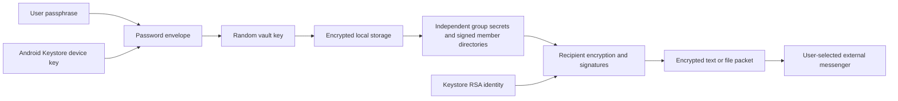

# Enigma system design

Version: 0.4.2 development build. Updated: 5 October 2026.

This is the living description of the implemented system. Update it with the code whenever its architecture, workflows, security or limitations change. Test evidence belongs in VERIFICATION.txt; threat details belong in SECURITY.md. Planned improvements are explicitly separated below.

## Purpose and trust model

Enigma encrypts offline text and arbitrary files for a selected device within an owner-managed group. An external messenger carries encrypted packets. Enigma has no account service, delivery server, Internet permission or VPN functionality. The source repository and APK distribution are private; public source code would not reveal randomly generated keys.

Every installation has a device identity. Each group has an independent 32-byte secret. A device identity can participate in multiple groups. New private packets require the intended sender/recipient private RSA key **and** the relevant group secret to decrypt. Knowing C's private key and the shared group secret must not reveal A↔B content, assuming A/B, their keys and their authenticated key bindings remain uncompromised.

The group owner authenticates the member directory. Trusting that owner delegates member introduction, not access to every recipient's private content. Names are owner-provided labels, not verified real-world identities. Initial pairing is performed directly with the known owner's and joiner's devices; signatures of included keys cannot independently establish a person's identity.

## Components

| Component | Responsibility |
|---|---|
| MainActivity (FragmentActivity) | Four-tab UI, locked/unlocked session, guided joining, encrypted history, external document/share workflows |
| Vault | Atomic encrypted group/configuration/history storage; loaded secrets live only in an unlocked session |
| PasswordLock / PasswordCipher | Device-bound, password-encrypted vault-key envelope; optional biometric envelope |
| Protocol | Identity, group generation, crypto primitives and retained older formats |
| PairingProtocol | Fresh join requests, recipient-encrypted invitations, owner-signed directories and join confirmations |
| GroupKey | New content-key derivation requiring endpoint secret plus group secret |
| DirectProtocol / FileProtocol | Signed recipient-private text / bounded chunked file encryption |
| QrTransfer / JoinScanActivity | Bounded frames, two offline camera paths, automatic/manual fallback and complete-transfer scanning |
| QrImage | Native QR rendering with normal-finder self-check and alternate mask selection |
| QrLuma | CameraX Y-plane extraction honoring vendor row/pixel stride |
| JoiningFlow | Fresh/resumed requests, bounded saved invitations, grant-scoped retry and pending cleanup |
| CameraActivity | Additional live camera entropy for group creation; no saved video/audio |



## Keys and algorithms

- Device identity: non-exportable RSA-2048 in Android Keystore, signing SHA256withRSA/PKCS#1 v1.5 and unwrapping RSA-OAEP. OAEP uses SHA-256, MGF1 SHA-1 and empty label explicitly for Android interoperability. The current identity is used for both signing and decryption.
- Device storage key: Keystore AES-256-GCM, retained alias quietkey.vault.v1. It encrypts the password envelope outside the password encryption layer.
- Vault master key: random 32 bytes. It encrypts vault format 2 with AES-256-GCM, fresh 12-byte nonce, 128-bit tag and AAD Enigma-vault-v2.
- App passphrase: 12–128 characters. Argon2id v1.3 derives a 32-byte envelope key with 16 random salt bytes, 64 MiB memory, three iterations and four lanes. Bouncy Castle 1.86 provides the low-level implementation; its JCA provider is not installed globally.
- Password envelope: AES-GCM protects the random master key. The device Keystore encrypts that complete envelope again. Fixed framing and bounded sizes prevent attacker-selected KDF resource inflation. Neither a UI success flag nor a stored password hash opens the vault.
- Optional biometric key: separate Keystore AES key, requires biometric authentication for each cryptographic operation and invalidates on changed biometric enrollment where supported. It wraps the same master key through AndroidX BiometricPrompt/CryptoObject, requesting BIOMETRIC_STRONG on supported API26+ devices. GCM AAD is supplied after authentication, immediately before finalization. Cancellation/stale callbacks cannot open a session. This is an explicitly authorized alternate unlocking route, not a second required factor. Password change disables this route.
- Group secret: independent 32 bytes per group, HKDF from fresh OS randomness with the live camera digest as additional salt input. OS randomness is the security foundation; camera input is not a measurable entropy guarantee. Group IDs are UUIDs.

Keys/plaintext exist in process memory during use. Byte arrays are cleared where practical, but Java cannot guarantee complete erasure. The RSA identity and device password-box key are not themselves configured for per-operation user authentication; a compromised executing app can potentially use these Keystore keys. Password/biometric protection does not promise safety on a fully compromised unlocked endpoint.

## Locked-session workflow

On first use the user chooses and repeats an app passphrase before device setup. Password entry is hidden by default, with an explicit visibility toggle that preserves the cursor and typed value. Existing development data may be opened during the initial password setup and rewritten with the random master key. Legacy data compatibility is not a supported release commitment.

Opening Enigma requires the passphrase or an explicitly enabled biometric route. Before successful decryption no groups, history or group secrets are loaded. Wrong-password attempts incur a persistent increasing UI delay capped at 60 seconds; this is not protection against offline guessing or a modified/rooted client. Argon2 is the computational barrier for copied password envelopes.

Leaving Enigma locks it, clears the visible data and queues disposal of loaded secrets. Screen-off always locks. Camera setup and Android document pickers receive a controlled session allowance of at most two minutes; QR scanning allows five minutes so the largest 64-frame transfer can complete at 2.5 seconds per frame. Screen-off still locks immediately; they are not general background-unlock permission. A generation counter rejects asynchronous results from an obsolete session. Streaming exports check the session while writing and request deletion of failed/partial destinations. External storage providers may retain copies or fail deletion.

Fresh passphrase authentication is required before readable-file export, reset, password change and biometric configuration. Biometric unlock does not replace the passphrase for these actions. There is no password recovery. Android Settings can clear data for a fresh start, losing the local identity/data. No automatic wiping follows failed passwords.

## Guided two-QR joining

```mermaid
sequenceDiagram
  participant A as Owner A
  participant B as Joining device B
  B->>B: Join group: create fresh signed request QR
  B-->>A: Show public-key/request QR
  A->>A: Invite new recipient: scan and confirm B
  A->>A: Sign updated directory; encrypt invitation for B
  A-->>B: Show recipient-specific invitation QR
  B->>B: Continuously scan, verify, decrypt and commit
  B-->>A: Optional signed confirmation or first verified reply
```

1. B taps Join group. QKJ1 contains B's public key, device name, a fresh random 16-byte request identifier and signed five-minute creation/expiry fields. Its signature binds the request to that key, but a photographed request is not proof of live physical presence. B's private key remains in Keystore.
2. A selects the group, taps Invite new recipient and scans directly from B's screen. After confirmation A records B as Invited and creates an owner-signed updated directory. Used identifiers are refused for new grants; exact pending grants can be resumed using JoiningFlow.
3. QKG2 encrypts the complete joining payload for B. A fresh AES key encrypts group ID/name/expiry, group secret and signed member directory; RSA-OAEP wraps the AES key only to B. The authenticated header binds owner public key, B fingerprint, request ID, creation/expiry, wrapped key and nonce. A signs the exact envelope. Invitation expiry is independent of the user's No-expiry message default.
4. B checks its active request, intended fingerprint, signature, lifetime, GCM authentication, owner-signed directory and membership before committing any trust. All public member keys import together. Duplicate group import refuses rather than replacing history/replay state. Consumed joining IDs are retained separately from groups, so deleting a group does not erase them.
5. B sees a simple success screen once the group is committed; no reverse invitation is required. A says Invited until QKA1 signed confirmation or B's first verified private text reply is received. The optional confirmation cannot grant new membership; it refers to an already-approved pending request. Offline delivery is not inferred from QR display.

For packets over 400 characters, either device cycles QKF1 frames with 320 payload characters every 2.5 seconds. The collector accepts up to 480 payload characters for previous development frames, at most 96 frames / 30,000 characters / five minutes, and verifies the complete SHA-256 digest before packet verification. Missing-frame numbers are shown; different/damaged codes keep collected frames until explicit Restart scan. This digest is transfer integrity, not sender authentication. No partial frame modifies trust.

Full-screen codes try the default QR mask, then masks 0–7 as needed; a mask is emitted only after ordinary QR finder detection returns the exact payload at the measured display size. This does not use PURE_BARCODE and does not establish camera performance. If no mask works at that size, the transfer screen keeps Copy transfer available. Codes use native whole-pixel encoding, error correction M, six-module margins, brightness and pause/previous/next. ZXing embedded 4.3.0 now uses core 3.5.3. The original SurfaceView/FitCenter/continuous-focus decoder remains the first path, preserving the reported working P30 behavior. After 12 seconds with no decoded code, or a legacy camera error, the scanner switches once to CameraX 1.4.2; users may switch either direction. CameraX uses Camera2, FIT_CENTER PreviewView, rear preview + latest-frame ImageAnalysis targeting 1280×720, stride-aware Y-plane copying, normal/inverted ZXing decoding and tap focus/exposure. Lifecycle/generation checks discard stale camera results; frame proxies always close, Y copies clear, and no camera images are stored. FLAG_SECURE and screen-on cover both paths. Vendor performance requires physical testing.

The joining request screen shows roles/steps, Scan owner's invitation, Start again and optional Paste invitation. Scanner cancel returns to these instructions. The owner gets instructions before scanning, confirms admission, and shows step 2. Copy transfer provides the exact public signed request or recipient-encrypted invitation through the clipboard; paste enters the same cryptographic path and owner confirmation as QR. It grants no additional authority. The initial known-owner/person authentication requirement still applies when using an external messenger.

invitationCache stores at most 64 request/group/member/encrypted-packet/expiry/directory-revision records inside the encrypted vault. Continue inviting reopens a pending grant after app restart. A used request can resume only its exact saved request/group/member with matching pending state and a present, unblocked recipient; unchanged directories reuse the packet, changed directories regenerate it after owner confirmation. Fresh requests replace old pending state for that group/member, retaining old used IDs. Expired cached entries are pruned when issuing invitations. Member/group removal cancels corresponding cache/pending entries, never used-request tombstones. Older uncached used requests require B's explicit Start again. Successful recipient import still refuses duplicate groups and commits consumption atomically. A group supports up to 30 devices.

The member directory has an owner signature, group ID, owner key, group expiry, positive increasing revision, group name and distinct fingerprint-checked public keys/names. Updates are verified against the pinned owner key. Older signed directories can authenticate old packets without rolling back current membership; conflicting equal revisions are refused. Locally blocked recipients stay blocked after updates; explicit owner reinvitation clears that device's local block. New text and file headers carry an encrypted signed directory, so existing members learn additions automatically when packets arrive. Offline phones do not update until a packet reaches them.

## New recipient-private packets

QKD3/direct-v3 and ENF1/file-v3 retain bounded signed packet framing but change the role of the RSA-wrapped value:

1. Generate a fresh random 32-byte endpoint secret R.
2. Wrap R separately to the chosen recipient and sender. Neither C nor another member receives a wrapped slot.
3. Build the complete header with group ID, sender/recipient fingerprints, creation/TTL, random message ID and nonce, both wrapped slots and an encrypted owner-signed directory carrier.
4. Derive the final AES key using HKDF-SHA256(input R, salt group secret, info versioned purpose + group ID + SHA-256 of the complete header).
5. AES-GCM encrypts content with exact header as AAD; the sender RSA signature authenticates the packet. Reception needs both R from an endpoint private key and the group secret.

Signatures authenticate identity; recipient encryption supplies confidentiality; the group secret is an additional requirement. One does not substitute for another. Third-member compromise is distinct from compromising A/B. Retained older QKD1/QKD2/file-v1/file-v2 packets do not acquire this group-secret requirement retroactively. Both devices need 0.4 for the new formats.

Text is at most 16,000 UTF-8 bytes. The enlarged bound accommodates a directory carrier: at most 75,000 wire characters, a 40,000-byte body and a 20,000-byte header. File data is at most 50 MiB, chunked at 65,536 bytes. Chunk nonce is an eight-byte random base plus four-byte sequence index. Each chunk authenticates header/index/kind; filename and MIME metadata are encrypted. Full inspection authenticates every chunk and the whole signature before readable export. No plaintext cache file is created.

Only explicit other group recipients may be selected; missing/self/unknown recipients are refused in the UI and protocol. The sender can reopen its sent copy. Group-wide broadcasts are not implemented.

## Storage and four tabs

- Home: select group/recipient and launch sending.
- Groups: create/join and a compact group list; each group opens details with Invite, member management, send, optional confirmation, rename and remove. Starter group replaces the misleading Personal vault label; it is not a separate personal file-storage feature.
- Messages: combined encrypted prepared/received text/file history across groups. Prepared is not delivered/read.
- Device: setup status/name, current version, updated guide, fingerprint, rename and reset. A separate Security & unlock page contains manual lock and passphrase/biometric settings.

groups.qkv holds group seeds, signed directories/revisions, aliases/local blocks, replay logs, joining state and encrypted text/history metadata inside AES-GCM vault encryption. password.qkl holds the double-encrypted master-key envelope. invitationCache holds bounded recipient-encrypted joining packets inside the same vault; pendingInvites maps request IDs to admitted members, and pairingUsed retains replay tombstones. Optional biometric.qkb holds a biometric-key-encrypted alternate master envelope. files/packages holds only signed endpoint/group-encrypted file packages with opaque UUID names.

Retain at most 200 message entries and 150 MiB of encrypted packages. Prune after a successful vault commit. Replay-ID logs remain separate, bounded at 100,000 per group; consumed joining history is capped at 10,000 per installation. Files shared via FileProvider are ciphertext from its nonexported encrypted-cache path, cleaned after 24 hours at next launch. Backups/device-transfer backups are disabled.

## Expiry, removal, reset and limits

Message TTL defaults to No expiry; choices remain five minutes, one hour, 24 hours, seven days and 30 days. Signed/GCM-authenticated timestamps are checked on opening, history reopening and file restoration. Device clocks, modified clients and saved plaintext are outside this policy. Group expiry is a separate ten-year local policy.

Removal blocks local use of that identity, but does not erase a secret from C's device. For revocation create a fresh group and invite only remaining members. Automatic secret rotation and authenticated rekey distribution are not implemented in 0.4. The UI must not describe local removal as group-wide revocation.

Reset requires fresh passphrase authentication and exact typed RESET. Android clears local app data/keys/permissions/grants and terminates the app, retaining the installed APK. Original/exported/shared files remain outside it. Forgotten-password reset through Android Settings is destructive, not recovery.

No forward secrecy, ratchet, post-compromise recovery, owner transfer, key export, network directory synchronization or independent audit is provided. A trusted/malicious/compromised owner can introduce deceptive names/new devices; established fingerprints must remain visible. The app cannot prevent recipients forwarding plaintext or an external messenger being sent to the wrong contact. Screenshots are blocked, but external cameras, keyboards and compromised OS/app execution remain risks.

## Verification and future work

Executed build/test evidence is recorded in VERIFICATION.txt, not inferred from this design. Required checks include wrong recipient/session, invitation/signature/GCM tampering, frame corruption/mixing, directory rollback/conflicts, automatic member introduction, C compromise, missing group secret, password cryptographic failures, locked-session cancellation, Keystore behavior and system-picker file restoration. Physical-phone pairing and vendor biometric behavior must be tested separately.

Planned work: reviewed ratcheting/forward secrecy; separate signing/decryption identities with explicit transition; authenticated group rekeying; dedicated personal file vault if requested; recovery design if requested; accessibility/device-size coverage; independent security audit. These are not claims about the current build.

## Change log

- 0.4.2 / 5 October 2026: two offline camera paths with automatic/manual fallback and stride-aware CameraX decoding; smaller frames, verified QR masks and missing-frame progress; numbered joining instructions, paste transport, simple success and explicit fresh restart; persisted pending invitation resumption and removal cleanup with retained replay protection.

- 0.4.1 / 4 October 2026: AndroidX cryptographic biometric prompt and post-authentication GCM handling; API26-compatible joining calls; unified continuous scanner with full preview/focus/light/progress; smaller full-screen cycling QR frames; visibility toggles for password entry; compact Home/Groups/Device and updated guide. Message cryptography and recipient requirements remain unchanged.
- 0.4 / 4 October 2026: guided recipient-specific joining, signed directory transport, cycling QR collection, passphrase-encrypted local storage, optional biometric envelope, session locking/fresh authentication, corrected group/endpoint key derivation; living design and repository maintenance instructions added.
- 0.3: four tabs, mandatory recipient selection, encrypted unified history, message TTL and reset.

References: [Android Keystore](https://developer.android.com/privacy-and-security/keystore), [cryptographic biometric authentication](https://developer.android.com/identity/sign-in/biometric-auth), [Argon2, RFC 9106](https://www.rfc-editor.org/rfc/rfc9106.html), [HKDF, RFC 5869](https://www.rfc-editor.org/rfc/rfc5869), [local-authentication weakness, OWASP](https://mas.owasp.org/MASWE/MASVS-AUTH/MASWE-0020/).
