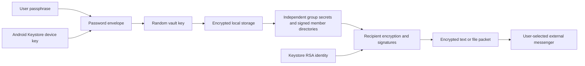

# Enigma system design

Version: 0.4.5 development build. Updated: 6 October 2026.

This is the living description of the implemented system. Update it with the code whenever its architecture, workflows, security or limitations change. Test evidence belongs in VERIFICATION.txt; threat details belong in SECURITY.md. Planned improvements are explicitly separated below.

## Purpose and trust model

Enigma encrypts offline text and arbitrary files for a selected device within an owner-managed group. An external messenger carries encrypted packets. Enigma has no account service, delivery backend or VPN functionality. It uses Android Internet permission for a temporary local hotspot joining socket, without Internet service requests. The source repository and APK distribution are private; public source code would not reveal randomly generated keys.

Every installation has a device identity. Each group has an independent 32-byte secret. A device identity can participate in multiple groups. New private packets require the intended sender/recipient private RSA key **and** the relevant group secret to decrypt. Knowing C's private key and the shared group secret must not reveal A↔B content, assuming A/B, their keys and their authenticated key bindings remain uncompromised.

The group owner authenticates the member directory. Trusting that owner delegates member introduction, not access to every recipient's private content. Names are owner-provided labels, not verified real-world identities. Initial pairing is performed directly with the known owner's and joiner's devices; signatures of included keys cannot independently establish a person's identity.

## Components

| Component | Responsibility |
|---|---|
| MainActivity (FragmentActivity) | Four-tab UI, locked/unlocked session, guided joining, encrypted history, external document/share workflows |
| Vault | Atomic encrypted group/configuration/history storage; loaded secrets live only in an unlocked session |
| PasswordLock / PasswordCipher | Device-bound, password-encrypted vault-key envelope; optional biometric envelope |
| Protocol | Identity, group generation, crypto primitives and retained older formats |
| PairingProtocol | Fresh join requests, recipient-encrypted invitations, owner-signed directories and join confirmations |
| GroupKey | New content-key derivation requiring endpoint secret plus group secret |
| DirectProtocol / FileProtocol | Signed recipient-private text / bounded chunked file encryption |
| QrTransfer / JoinScanActivity | Bounded frames, original ZXing camera defaults, explicit alternate and manual code acknowledgements |
| QrTransferDialog | Non-floating full-screen transfer, width-based square QR, manual advance and explicit swap screen |
| QrImage | Native QR rendering with normal-finder self-check and alternate mask selection |
| QrLuma | CameraX Y-plane extraction honoring vendor row/pixel stride |
| JoiningFlow | Fresh/resumed requests, bounded saved invitations, grant-scoped retry and pending cleanup |
| NearbyJoinDialog / ConnectionCard | Automatic foreground hotspot listener; single compact address/code card, manual fallback, bounded transfer lifecycle |
| IncomingText | Bounded copy/paste normalization and untrusted group routing, followed by complete normal authentication |
| UsbJoinLink | AOA host/accessory permission, re-enumeration, buffered USB data endpoints; no ADB |
| LocalJoinWire / LocalJoinSession | Bounded ordered duplex exchange; authenticated hotspot frames; approval/receipt ordering |
| CameraActivity | Additional live camera entropy for group creation; no saved video/audio |



## Keys and algorithms

- Device identity: non-exportable RSA-2048 in Android Keystore, signing SHA256withRSA/PKCS#1 v1.5 and unwrapping RSA-OAEP. OAEP uses SHA-256, MGF1 SHA-1 and empty label explicitly for Android interoperability. The current identity is used for both signing and decryption.
- Device storage key: Keystore AES-256-GCM, retained alias quietkey.vault.v1. It encrypts the password envelope outside the password encryption layer.
- Vault master key: random 32 bytes. It encrypts vault format 2 with AES-256-GCM, fresh 12-byte nonce, 128-bit tag and AAD Enigma-vault-v2.
- App passphrase: 12–128 characters. Argon2id v1.3 derives a 32-byte envelope key with 16 random salt bytes, 64 MiB memory, three iterations and four lanes. Bouncy Castle 1.86 provides the low-level implementation; its JCA provider is not installed globally.
- Password envelope: AES-GCM protects the random master key. The device Keystore encrypts that complete envelope again. Fixed framing and bounded sizes prevent attacker-selected KDF resource inflation. Neither a UI success flag nor a stored password hash opens the vault.
- Optional biometric key: separate Keystore AES key, requires biometric authentication for each cryptographic operation and invalidates on changed biometric enrollment where supported. It wraps the same master key through AndroidX BiometricPrompt/CryptoObject, requesting BIOMETRIC_STRONG on supported API26+ devices. GCM AAD is supplied after authentication, immediately before finalization. Cancellation/stale callbacks cannot open a session. This is an explicitly authorized alternate unlocking route, not a second required factor. Password change disables this route.
- Group secret: independent 32 bytes per group, HKDF from fresh OS randomness with the live camera digest as additional salt input. OS randomness is the security foundation; camera input is not a measurable entropy guarantee. Group IDs are UUIDs.

Keys/plaintext exist in process memory during use. Byte arrays are cleared where practical, but Java cannot guarantee complete erasure. The RSA identity and device password-box key are not themselves configured for per-operation user authentication; a compromised executing app can potentially use these Keystore keys. Password/biometric protection does not promise safety on a fully compromised unlocked endpoint.

## Locked-session workflow

On first use the user chooses and repeats an app passphrase before device setup. Password entry is hidden by default, with an explicit visibility toggle that preserves the cursor and typed value. Existing development data may be opened during the initial password setup and rewritten with the random master key. Legacy data compatibility is not a supported release commitment.

Opening Enigma requires the passphrase or an explicitly enabled biometric route. Before successful decryption no groups, history or group secrets are loaded. Wrong-password attempts incur a persistent increasing UI delay capped at 60 seconds; this is not protection against offline guessing or a modified/rooted client. Argon2 is the computational barrier for copied password envelopes.

Leaving Enigma locks it, clears the visible data and queues disposal of loaded secrets. Screen-off always locks. Camera setup and Android document pickers receive a controlled session allowance of at most two minutes; QR scanning allows five minutes for manually acknowledging each code in a bounded transfer. Screen-off still locks immediately; they are not general background-unlock permission. A generation counter rejects asynchronous results from an obsolete session. Streaming exports check the session while writing and request deletion of failed/partial destinations. External storage providers may retain copies or fail deletion.

Fresh passphrase authentication is required before readable-file export, reset, password change and biometric configuration. Biometric unlock does not replace the passphrase for these actions. There is no password recovery. Android Settings can clear data for a fresh start, losing the local identity/data. No automatic wiping follows failed passwords.

## Personal-hotspot and USB joining

```mermaid
sequenceDiagram
  participant A as Group owner A
  participant B as Recipient B
  A->>A: Invite new recipient; choose USB or hotspot
  B->>B: Join group; choose same method; fresh signed request
  B->>A: QKJ1 over connected cable or code-protected local socket
  A->>A: Verify request; user confirms device; persist approved grant
  A->>B: QKG2 encrypted only for B with full group and directory
  B->>B: Verify and decrypt; user confirms group/owner; persist group
  B->>A: QKA1 signed receipt
  A->>A: Verify pending grant; persist Joined; remove pending cache
  A->>B: Done
```

Groups → Join group and Invite new recipient present Personal hotspot (recommended), USB cable, then QR fallback. Nearby joining regenerates the active signed request while retaining the device identity. MainActivity owns the unlocked vault and both approval dialogs. Neither transport holds identity private keys or plaintext group secrets. Parsed candidate group secrets exist transiently in MainActivity until the recipient confirms; cancellation clears uncommitted material. Owner approval persists the member as Invited before delivery; only a verified receipt/message makes it Joined. Failed delivery or recipient decline does not undo an owner-authorized pending grant. Remove the pending member or retry a fresh request to resolve it. A commit is retained if the last confirmation is lost. Done returns to Home; exactly one other member is selected automatically and visibly. Multiple possible recipients still require a choice.

**USB:** UsbJoinLink polls only while the joining window is open. It can connect through either host or accessory APIs independently of owner/joiner role. A package-scoped mutable PendingIntent (API31+) preserves USB permission result extras; it uses a random action, nonexported receiver and cancellation on close. UsbManager permission is rechecked before opening endpoints. A single attached device requires Android permission, then AOA GET_PROTOCOL (51), SEND_STRING (52) and START (53); after re-enumeration it requests permission for the accessory data device. Google VID 0x18d1 / PID 0x2d00 or 0x2d01, interface zero, bulk IN/OUT are used. The optional ADB interface is never opened. The accessory side matches Enigma / Enigma Join strings, asks permission and opens duplicated file-descriptor handles. A 16-KiB buffered input accommodates entire AOA logical packets before byte-level framing; writes are chunked to 16 KiB. Disconnect, cancellation, lock and deadline close handles. A data cable/OTG host and compatible accessory mode are necessary; no USB debugging, computer, root, tethering or file-copy workaround is used. String metadata and a cable alone are not cryptographic real-world identity proof. Phone interoperability is pending physical verification.

**Personal hotspot:** Configure the owner's hotspot and connect B using Android Settings. The app does not start a hotspot, discover nearby networks or join Wi-Fi itself. Returning from Open connection settings reopens the flow with a fresh request/code while the bounded unlocked handoff remains valid. Private IPv4 Wi-Fi/hotspot/Ethernet/tether interfaces are enumerated, preferring swlan/ap names. The owner listener starts automatically on the first address and TCP port 45873; Use another local address closes it and starts a fresh dialog/code bound to the chosen interface. B's manual address prefills from the Wi-Fi gateway when available. The joining socket binds explicitly to a connected non-VPN Android Wi-Fi Network instead of the default/mobile-data network. Only literal RFC1918 addresses are accepted; no hostname/public/loopback/link-local endpoint or discovery request is used. Same-private-Wi-Fi joining works unless client isolation/routing prevents it. INTERNET grants broader OS capability than these implemented private-endpoint guards.

**Connection card:** QKC1:private-address:temporary-code is under 70 ASCII characters for emitted cards. It contains no identity/private/group keys. Owner shows one ordinary QR rendered by QrImage and optionally copies the exact card on explicit request. B's existing scanner accepts only a valid card and immediately returns it, without manual frame/Continue/Swap controls. MainActivity closes B's old transport, uses the bounded scanner handoff, reopens the same signed request and connects using the card. Paste connection card follows the same parser and local socket path. The existing five-minute listener lifetime and code authentication remain; the card is a connection hint/secret, not a membership grant. Owner Invite and recipient Join group still gate trust/persistence. The existing multi-frame joining fallback remains unchanged; physical-camera reliability is unverified.

The temporary code is 20 independent random symbols from a 32-character unambiguous alphabet, displayed as five parts: 100-bit random secret, separate from hotspot/app passwords. SHA-256(versioned prefix + normalized code) derives a 32-byte transport key. Each Wi-Fi frame uses AES-GCM, fresh 12-byte nonce and full framing header AAD. The secret stays in RAM, is not saved/logged/autocopied and expires with the five-minute window. It authenticates code possession, so share directly only with the known recipient. USB uses the same framing without this outer code encryption; QKG2 remains recipient-encrypted on both transports. The code is not a replacement for owner approval or public-key/request/signature/lifetime verification.

LocalJoinWire EJW1 uses 4-byte magic, 1-byte mode, 1-byte type, 4-byte per-direction sequence and 4-byte length. Plain ASCII payload limits: QKJ1 1,600, QKG2 30,000, QKA1 1,500, Done exact Joined (6). Encrypted bodies add a 12-byte nonce and 16-byte tag. Allocations are bounded before reading. Ordering is request/invitation/receipt/done; each direction permits two frames and refuses downgrade, wrong direction/type, bad sequence and malformed/truncated input. LocalJoinSession gates messages on CompletableFuture approvals and a monotonic deadline; MainActivity executes crypto/persistence on its existing worker. The owner TCP listener permits at most five failed initial connections, with ten-second initial reads and one verified request per session. Remaining network reads and UI approvals have the overall five-minute watchdog. Cancel/lock/background/destruction closes transport and cancels approvals. Screen-off always locks; USB permission prompts have a controlled five-minute handoff, connection settings two minutes. Returning from settings clears that allowance through an ActivityResult callback before any new joining attempt. No service/background listener is installed.

A successful screen requires B's durable commit and A's verified receipt. If final acknowledgement fails, B can retain the imported group while A still says Invited or B reports interrupted confirmation. A verified message confirms it later. Cryptographic admission is identical to QR; no reverse invitation or separate public-key scan is needed. Android 16's optional local-network restriction and future target changes require separate permission validation. Physical S23/P30 USB roles, accessory prompts, hotspot isolation and complete two-phone exchange remain explicitly unverified.

## QR fallback (deferred)

The manual QR implementation from 0.4.3 is retained without camera changes. Choose QR fallback in the method chooser; saved grants and QR confirmation move under the owner's invitation chooser. S23 detection/focus remains unresolved. The retained flow is described below.


```mermaid
sequenceDiagram
  participant A as Owner A
  participant B as Joining device B
  B->>B: Join group: create fresh signed request QR
  B-->>A: Show public-key/request QR
  A->>A: Invite new recipient: scan and confirm B
  A->>A: Sign updated directory; encrypt invitation for B
  A-->>B: Show recipient-specific invitation QR
  B->>B: Scan each stationary code; acknowledge; then verify, decrypt and commit
  B-->>A: Optional signed confirmation or first verified reply
```

1. B taps Join group → QR fallback. QKJ1 contains B's public key, device name, a fresh random 16-byte request identifier and signed five-minute creation/expiry fields. Its signature binds the request to that key, but a photographed request is not proof of live physical presence. B's private key remains in Keystore.
2. A selects the group, taps Invite new recipient → QR fallback and scans directly from B's screen. After confirmation A records B as Invited and creates an owner-signed updated directory. Used identifiers are refused for new grants; exact pending grants can be resumed using JoiningFlow.
3. QKG2 encrypts the complete joining payload for B. A fresh AES key encrypts group ID/name/expiry, group secret and signed member directory; RSA-OAEP wraps the AES key only to B. The authenticated header binds owner public key, B fingerprint, request ID, creation/expiry, wrapped key and nonce. A signs the exact envelope. Invitation expiry is independent of the user's No-expiry message default.
4. B checks its active request, intended fingerprint, signature, lifetime, GCM authentication, owner-signed directory and membership before committing any trust. All public member keys import together. Duplicate group import refuses rather than replacing history/replay state. Consumed joining IDs are retained separately from groups, so deleting a group does not erase them.
5. B sees a simple success screen once the group is committed; no reverse invitation is required. A says Invited until QKA1 signed confirmation or B's first verified private text reply is received. The optional confirmation cannot grant new membership; it refers to an already-approved pending request. Offline delivery is not inferred from QR display.

For packets over 400 characters, devices show QKF1 frames with 320 payload characters. Each code stays still until the displaying user taps Next code. The scanner pauses after each new unique frame, shows Code scanned and waits for Scan next code. Duplicate frames do not advance progress. The final Continue/Join group returns the complete packet for normal verification. Camera switching preserves collected frames. The collector accepts up to 480 payload characters for previous development frames, at most 96 frames / 30,000 characters / five minutes, and verifies the complete SHA-256 digest before packet verification. Wrong/damaged codes keep collected frames until explicit Restart scan. No partial frame modifies trust; SHA-256 transfer integrity is not sender authentication.

QrTransferDialog uses the app's non-floating theme, system insets and a scrollable content area. QR dimensions are determined by screen width, never by the height left after captions/buttons. Only the primary Next/Swap action remains below the content; additional controls are under More. After the request's last code, a separate Swap phones screen says the owner should confirm Invite and show invitation codes. Starting the return scan requires an explicit button. Showing/advancing codes does not prove delivery. A's status stays Invited until verified acknowledgement/message.

Full-screen codes try the default QR mask, then masks 0–7 until ordinary finder detection returns the exact payload at measured native size. Error correction M, six-module margins and brightness remain. This self-check does not establish camera performance. The camera's first path restores release 1's DecoratedBarcodeView, default TextureView/framing and periodic AUTO autofocus; the forced SurfaceView/FitCenter/full-frame/continuous-focus setup is removed. QR-only normal/inverted decoding remains. There is no automatic camera switch. More → Try other scanner explicitly selects CameraX 1.4.2/Camera2, FIT_CENTER preview + latest-frame ImageAnalysis at target 1280×720, stride-aware Y extraction and tap focus/exposure. Each accepted frame stops preview/analysis until manual continuation; generation checks reject stale callbacks. Proxies close, copies clear, no camera images are stored. FLAG_SECURE, screen-on and bounded handoff remain.

Copy/Paste, Start again and Previous code are in the display's More menu. The scanner's More menu provides Light, alternate camera, Restart scan and matching paste transport. Copying the exact signed QKJ1 or recipient-encrypted QKG2 changes no consent/verification. Cancelling B's scanner returns to the request page; Owner already has my codes resumes the swap step. The known-owner/person authentication requirement remains when using a messenger. Saved invitation resumption and used-request tombstones from 0.4.2 remain unchanged. Continue QR invitation and Scan QR confirmation are now under Invite new recipient.

The encrypted vault retains at most 64 pending invitation records: exact request, group/member, ciphertext, expiry and roster revision. JoiningFlow permits a consumed request to resume only its still-pending exact grant with the member present and unblocked. An unchanged roster returns identical ciphertext; a changed roster produces a new owner-signed packet after confirmation. Removal of a member/group or replacement with a fresh request cancels corresponding cached grants/mappings while retaining the permanent used-ID ledger (maximum 10,000). Expired/uncached/removed requests require More → Start again on B; this replaces the active session without replacing B's identity. A stale receipt cannot confirm a replacement grant. Receipt/message verification cleans up completed cached grants. No reset is required for joining recovery.

## New recipient-private packets

QKD3/direct-v3 and ENF1/file-v3 retain bounded signed packet framing but change the role of the RSA-wrapped value:

1. Generate a fresh random 32-byte endpoint secret R.
2. Wrap R separately to the chosen recipient and sender. Neither C nor another member receives a wrapped slot.
3. Build the complete header with group ID, sender/recipient fingerprints, creation/TTL, random message ID and nonce, both wrapped slots and an encrypted owner-signed directory carrier.
4. Derive the final AES key using HKDF-SHA256(input R, salt group secret, info versioned purpose + group ID + SHA-256 of the complete header).
5. AES-GCM encrypts content with exact header as AAD; the sender RSA signature authenticates the packet. Reception needs both R from an endpoint private key and the group secret.

Signatures authenticate identity; recipient encryption supplies confidentiality; the group secret is an additional requirement. One does not substitute for another. Third-member compromise is distinct from compromising A/B. Retained older QKD1/QKD2/file-v1/file-v2 packets do not acquire this group-secret requirement retroactively. Both devices need 0.4 for the new formats.

Text is at most 16,000 UTF-8 bytes. The enlarged bound accommodates a directory carrier: at most 75,000 wire characters, a 40,000-byte body and a 20,000-byte header. File data is at most 50 MiB, chunked at 65,536 bytes. Chunk nonce is an eight-byte random base plus four-byte sequence index. Each chunk authenticates header/index/kind; filename and MIME metadata are encrypted. Full inspection authenticates every chunk and the whole signature before readable export. No plaintext cache file is created.

Only other group recipients may be selected. With exactly one other member, the UI selects and displays that person automatically; with several, a choice is required. Missing/self/unknown recipients are refused in the UI and protocol. The sender can reopen its sent copy. Group-wide broadcasts are not implemented.

## Storage and four tabs

- Home: select group/recipient and launch sending.
- Groups: create/join and a compact group list; each group opens details with Invite, member management, send, optional confirmation, rename and remove. Starter group replaces the misleading Personal vault label; it is not a separate personal file-storage feature.
- Messages: combined encrypted prepared/received text/file history across groups. A separate receive screen offers Paste and open with no group/recipient/TTL selection. Prepared is not delivered/read.
- Device: setup status/name, current version, updated guide, fingerprint, rename and reset. A separate Security & unlock page contains manual lock and passphrase/biometric settings.

groups.qkv holds group seeds, signed directories/revisions, aliases/local blocks, replay logs, joining state and encrypted text/history metadata inside AES-GCM vault encryption. password.qkl holds the double-encrypted master-key envelope. invitationCache holds bounded recipient-encrypted joining packets inside the same vault; pendingInvites maps request IDs to admitted members, and pairingUsed retains replay tombstones. Optional biometric.qkb holds a biometric-key-encrypted alternate master envelope. files/packages holds only signed endpoint/group-encrypted file packages with opaque UUID names.

Retain at most 200 message entries and 150 MiB of encrypted packages. Prune after a successful vault commit. Replay-ID logs remain separate, bounded at 100,000 per group; consumed joining history is capped at 10,000 per installation. Files shared via FileProvider are ciphertext from its nonexported encrypted-cache path, cleaned after 24 hours at next launch. Backups/device-transfer backups are disabled.

IncomingText caps raw input at 100,000 characters and normalized packets at 75,000; it removes whitespace and permits only supported QKD1/2/3 or QKM1 plus URL-safe Base64. Bounded binary framing supplies an untrusted group ID. FileProtocol.groupId reads a bounded header from the capped ciphertext file. These hints select an already stored group, never create trust. DirectProtocol/Protocol/FileProtocol then perform their complete signature/key/directory/expiry/replay checks. Missing groups get a join-the-sender's-group error. Valid content is persisted before display; no partial parse shows plaintext.

MainActivity accepts ACTION_SEND text/plain and application/octet-stream, with singleTop delivery. Incoming encrypted text/URI waits for vault unlock; input is bounded, files are copied within existing limits and authenticated normally. The URI must be readable through Android's granted access. Ciphertext pending across Activity recreation may be saved in instance state after format normalization; no decrypted body is saved. The intent extras are consumed to avoid reopening the same packet on recreation. Readable-file export retains fresh passphrase authentication. Compose refuses common encrypted packet prefixes to prevent accidental double encryption.

## Expiry, removal, reset and limits

Message TTL defaults to No expiry; choices remain five minutes, one hour, 24 hours, seven days and 30 days. Signed/GCM-authenticated timestamps are checked on opening, history reopening and file restoration. Device clocks, modified clients and saved plaintext are outside this policy. Group expiry is a separate ten-year local policy.

Removal blocks local use of that identity, but does not erase a secret from C's device. For revocation create a fresh group and invite only remaining members. Automatic secret rotation and authenticated rekey distribution are not implemented in 0.4. The UI must not describe local removal as group-wide revocation.

Reset requires fresh passphrase authentication and exact typed RESET. Android clears local app data/keys/permissions/grants and terminates the app, retaining the installed APK. Original/exported/shared files remain outside it. Forgotten-password reset through Android Settings is destructive, not recovery.

No forward secrecy, ratchet, post-compromise recovery, owner transfer, key export, network directory synchronization or independent audit is provided. A trusted/malicious/compromised owner can introduce deceptive names/new devices; established fingerprints must remain visible. The app cannot prevent recipients forwarding plaintext or an external messenger being sent to the wrong contact. Screenshots are blocked, but external cameras, keyboards and compromised OS/app execution remain risks.

## Verification and future work

Executed build/test evidence is recorded in VERIFICATION.txt, not inferred from this design. Required checks include wrong recipient/session, invitation/signature/GCM tampering, frame corruption/mixing, directory rollback/conflicts, automatic member introduction, C compromise, missing group secret, password cryptographic failures, locked-session cancellation, Keystore behavior and system-picker file restoration. Physical-phone pairing and vendor biometric behavior must be tested separately.

Planned work: reviewed ratcheting/forward secrecy; separate signing/decryption identities with explicit transition; authenticated group rekeying; dedicated personal file vault if requested; recovery design if requested; accessibility/device-size coverage; independent security audit. These are not claims about the current build.

## Change log

- 0.4.5 / 6 October 2026: automatic hotspot waiting and settings-return resumption; one compact connection card with scan/paste and manual fallback; hotspot-first chooser; automatic visible two-person recipient; separate receive UI, Android share reception and bounded text/file group routing. Message cryptography and signed joining grants are unchanged. Regression checks explicitly cover Starter-group selection and first messages after joining; executed evidence and remaining phone checks are in VERIFICATION.txt.

- 0.4.4 / 6 October 2026: USB-first joining, personal-hotspot alternative, QR deferred to fallback; AOA host/accessory adapter, temporary-code authenticated local frames, two-sided consent and automatic signed confirmation; foreground transport lifecycle and updated device guide.

- 0.4.3 / 5 October 2026: restore release 1 standard scanner/autofocus defaults; remove automatic camera switching and QR cycling; fixed square full-screen QR/camera areas with scrollable text; manual per-code success/continuation, explicit swap and completion screens; rendered-pixel/layout regressions at small screens and enlarged text.

- 0.4.2 / 5 October 2026: two offline camera paths with automatic/manual fallback and stride-aware CameraX decoding; smaller frames, verified QR masks and missing-frame progress; numbered joining instructions, paste transport, simple success and explicit fresh restart; persisted pending invitation resumption and removal cleanup with retained replay protection.

- 0.4.1 / 4 October 2026: AndroidX cryptographic biometric prompt and post-authentication GCM handling; API26-compatible joining calls; unified continuous scanner with full preview/focus/light/progress; smaller full-screen cycling QR frames; visibility toggles for password entry; compact Home/Groups/Device and updated guide. Message cryptography and recipient requirements remain unchanged.
- 0.4 / 4 October 2026: guided recipient-specific joining, signed directory transport, cycling QR collection, passphrase-encrypted local storage, optional biometric envelope, session locking/fresh authentication, corrected group/endpoint key derivation; living design and repository maintenance instructions added.
- 0.3: four tabs, mandatory recipient selection, encrypted unified history, message TTL and reset.

References: [Android Keystore](https://developer.android.com/privacy-and-security/keystore), [cryptographic biometric authentication](https://developer.android.com/identity/sign-in/biometric-auth), [Argon2, RFC 9106](https://www.rfc-editor.org/rfc/rfc9106.html), [HKDF, RFC 5869](https://www.rfc-editor.org/rfc/rfc5869), [local-authentication weakness, OWASP](https://mas.owasp.org/MASWE/MASVS-AUTH/MASWE-0020/).
