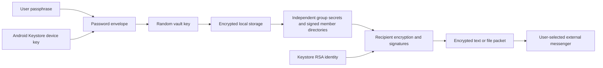

# Enigma system design

Version: 0.6.0 development build. Updated: 29 October 2026 (0.7.0 message-security proposal added; not implemented).

This is the living description of the implemented system. Update it with the code whenever its architecture, workflows, security or limitations change. Test evidence belongs in VERIFICATION.txt; threat details belong in SECURITY.md. Planned improvements are explicitly separated below.

## Purpose and trust model

Enigma encrypts offline text and arbitrary files for a selected device within an owner-managed group. An external messenger carries encrypted packets. Enigma has no account service, delivery backend or VPN functionality. It uses Android Internet permission for a temporary local joining socket over an app-started local-only hotspot or shared Wi-Fi, without Internet service requests. The source repository and APK distribution are private; public source code would not reveal randomly generated keys.

Every installation has a device identity. Each group has an independent 32-byte secret. A device identity can participate in multiple groups. New private packets require the intended sender/recipient private RSA key **and** the relevant group secret to decrypt. Knowing C's private key and the shared group secret must not reveal A↔B content, assuming A/B, their keys and their authenticated key bindings remain uncompromised.

The group owner authenticates the member directory. Trusting that owner delegates member introduction, not access to every recipient's private content. Names are owner-provided labels, not verified real-world identities. Initial pairing is performed directly with the known owner's and joiner's devices; signatures of included keys cannot independently establish a person's identity.

## Components

| Component | Responsibility |
|---|---|
| MainActivity (FragmentActivity) | Three-tab UI (Messages, Groups, Device), locked/unlocked session, guided joining, conversations, send/receive, in-memory viewer, external document/share/open workflows |
| Inbox | Pure-Java conversation grouping (group + other member), typed-message file naming and in-app preview classification |
| Vault | Atomic encrypted group/configuration/history storage; loaded secrets live only in an unlocked session |
| PasswordLock / PasswordCipher | Device-bound, password-encrypted vault-key envelope; optional biometric envelope |
| Protocol | Identity, group generation, crypto primitives and retained older formats |
| PairingProtocol | Fresh join requests, recipient-encrypted invitations, owner-signed directories and join confirmations |
| GroupKey | New content-key derivation requiring endpoint secret plus group secret |
| DirectProtocol / FileProtocol | Signed recipient-private text / bounded chunked file encryption |
| QrImage | Native QR rendering with normal-finder self-check and alternate mask selection (single joining code) |
| JoiningFlow | Fresh/resumed requests, bounded saved invitations, grant-scoped retry and pending cleanup |
| NearbyJoinDialog | Foreground full-screen nearby joining: local-only hotspot or same Wi-Fi, single QR display, NFC reader, Wi-Fi network request, check codes, bounded lifecycle |
| JoinBootstrap | QKB1 single-QR/NFC packet, one-time KEK, transport-key and check-code derivation, owner pinning |
| JoinNfcService | NFC host card emulation serving QKB1 only while an invite screen is open; reader helper |
| LocalJoinWire / LocalJoinSession | Bounded ordered duplex exchange; KEK-authenticated frames; approval/receipt ordering |
| CameraActivity | Additional live camera entropy for group creation; no saved video/audio |



## Keys and algorithms

- Device identity: non-exportable RSA-2048 in Android Keystore, signing SHA256withRSA/PKCS#1 v1.5 and unwrapping RSA-OAEP. OAEP uses SHA-256, MGF1 SHA-1 and empty label explicitly for Android interoperability. The current identity is used for both signing and decryption.
- Device storage key: Keystore AES-256-GCM, retained alias quietkey.vault.v1. It encrypts the password envelope outside the password encryption layer.
- Vault master key: random 32 bytes. It encrypts vault format 2 with AES-256-GCM, fresh 12-byte nonce, 128-bit tag and AAD Enigma-vault-v2.
- App passphrase: 12–128 characters. Argon2id v1.3 derives a 32-byte envelope key with 16 random salt bytes, 64 MiB memory, three iterations and four lanes. Bouncy Castle 1.86 provides the low-level implementation; its JCA provider is not installed globally.
- Password envelope: AES-GCM protects the random master key. The device Keystore encrypts that complete envelope again. Fixed framing and bounded sizes prevent attacker-selected KDF resource inflation. Neither a UI success flag nor a stored password hash opens the vault.
- Optional biometric key: separate Keystore AES key, requires biometric authentication for each cryptographic operation and invalidates on changed biometric enrollment where supported. It wraps the same master key through AndroidX BiometricPrompt/CryptoObject, requesting BIOMETRIC_STRONG on supported API26+ devices. GCM AAD is supplied after authentication, immediately before finalization. Cancellation/stale callbacks cannot open a session. This is an explicitly authorized alternate unlocking route, not a second required factor. Password change disables this route.
- Group secret: independent 32 bytes per group, HKDF from fresh OS randomness with the live camera digest as additional salt input. OS randomness is the security foundation; camera input is not a measurable entropy guarantee. Group IDs are UUIDs.

Keys/plaintext exist in process memory during use. Byte arrays are cleared where practical, but Java cannot guarantee complete erasure. The RSA identity and device password-box key are not themselves configured for per-operation user authentication; a compromised executing app can potentially use these Keystore keys. Password/biometric protection does not promise safety on a fully compromised unlocked endpoint.

## Locked-session workflow

On first use the user chooses and repeats an app passphrase before device setup. Password entry is hidden by default, with an explicit visibility toggle that preserves the cursor and typed value. Existing development data may be opened during the initial password setup and rewritten with the random master key. Legacy data compatibility is not a supported release commitment.

Opening Enigma requires the passphrase or an explicitly enabled biometric route. Before successful decryption no groups, history or group secrets are loaded. Wrong-password attempts incur a persistent increasing UI delay capped at 60 seconds; this is not protection against offline guessing or a modified/rooted client. Argon2 is the computational barrier for copied password envelopes.

Leaving Enigma locks it, clears the visible data and queues disposal of loaded secrets. Screen-off always locks. Camera setup and Android document pickers receive a controlled session allowance of at most two minutes; scanning the joining code allows five minutes and the Wi-Fi connection prompt 90 seconds. Screen-off still locks immediately; they are not general background-unlock permission. A generation counter rejects asynchronous results from an obsolete session. Streaming exports check the session while writing and request deletion of failed/partial destinations. External storage providers may retain copies or fail deletion.

Fresh passphrase authentication is required before readable-file export, reset, password change and biometric configuration. Biometric unlock does not replace the passphrase for these actions. There is no password recovery. Android Settings can clear data for a fresh start, losing the local identity/data. No automatic wiping follows failed passwords.

## Joining: nearby (single QR or NFC tap, then Wi-Fi) and manual files

Joining is a separate layer from message encryption. It delivers one group's secret, settings and owner-signed directory to one approved device; message/file keys (below) are derived per packet and never reuse joining keys.

```mermaid
sequenceDiagram
  participant A as Group owner A
  participant B as Recipient B
  A->>A: Invite → Nearby; start local-only hotspot; bind listener; fresh 32-byte KEK
  A-->>B: QKB1 as one QR or NFC tap (SSID, passphrase, IP/port, KEK, owner fingerprint, expiry)
  B->>B: Join → Scan or tap; Wi-Fi network request; fresh signed QKJ1
  B->>A: QKJ1 in EJW1 frame (AES-GCM, key = HKDF(KEK))
  A->>A: Show check code = HKDF(KEK, SHA-256(QKJ1)); owner confirms codes match; persist grant
  A->>B: QKG2 encrypted only to B's Keystore key, owner-signed, full group + directory
  B->>B: Verify; require owner == QKB1 fingerprint; show same check code; user confirms; commit
  B->>A: QKA1 signed receipt
  A->>A: Verify pending grant; persist Joined
  A->>B: Done
```

### Protection layers for the group secret

1. Wi-Fi WPA2/WPA3 of the temporary local-only hotspot or shared private Wi-Fi. Not relied on: the QR reveals the hotspot password and a spoofed access point is assumed.
2. One-time KEK from QKB1. JoinBootstrap.transportKey() = HKDF-SHA256(KEK, "Enigma/join-bootstrap/v1", "transport") keys every LocalJoinWire EJW1 frame (AES-256-GCM, fresh 12-byte nonce, header as AAD).
3. QKG2 recipient encryption and owner signature (unchanged): a fresh AES key RSA-OAEP-wrapped only to B, AES-GCM over group ID/name/expiry/secret/directory, header binding owner key, B fingerprint, request ID and lifetime. Holding the KEK does not open it. B additionally refuses any invitation whose owner fingerprint differs from QKB1.

### Owner side

Groups → group → Invite new recipient offers, as app-styled buttons with one-line explanations: **Nearby: scan or tap** (recommended), **Nearby on the same Wi-Fi**, **By file: open their request** and **By file: open their confirmation**. Nearby asks for ACCESS_FINE_LOCATION+COARSE (API 26–32, maxSdkVersion 32) or NEARBY_WIFI_DEVICES with neverForLocation (33+) only when chosen, then NearbyJoinDialog calls WifiManager.startLocalOnlyHotspot. SSID/passphrase/security come from the reservation (SoftApConfiguration on 30+, WifiConfiguration before). The hotspot address is the private IPv4 that appears on a Wi-Fi/AP interface after start (polled up to six seconds; falls back to an address ending .1). Same-Wi-Fi mode uses the current Wi-Fi network's link address. A ServerSocket binds to that address only on port 45873 (ephemeral if busy) before QKB1 is built with the bound port.

QKB1 ("bootstrap-v1", about 250 characters) contains mode, SSID, passphrase, security type, IPv4, port, KEK, owner fingerprint and expiry (five minutes). It is rendered as one QR (QrImage self-checked mask) and published to JoinNfcService. On Android 15+ the owner also calls NfcAdapter.setDiscoveryTechnology(FLAG_READER_DISABLE, FLAG_LISTEN_KEEP) while the code is shown (reset on every exit), so its own NFC poller cannot read the recipient phone and open Android's "Empty tag" screen, which would background and lock Enigma. The listener allows at most five failed initial connections with ten-second reads, accepts one verified request, clears the NFC payload, shows the check code in the Invite consent dialog and proceeds only on **Codes match · Invite**. JoiningFlow.invite persists the Invited grant before sending QKG2. The hotspot reservation, listener and KEK are released on success, Cancel, failure, lock or the five-minute deadline.

### Recipient side

Groups → Join group offers **Nearby: scan or tap** (recommended), **By file: save my request** and **By file: open the owner's invitation**; the nearby screen's button is **Scan QR code**, matching the owner's on-screen instructions. Nearby creates a fresh signed QKJ1, then accepts QKB1 from the ZXing ScanContract (SecureCaptureActivity, FLAG_SECURE, five-minute handoff) or from NFC reader mode (IsoDep select of AID F0454E49474D4101, then chunked reads). Android disables reader mode whenever the activity pauses (for example the QR scanner); MainActivity.onResume re-arms it while the recipient is still waiting, otherwise the phone would read the owner as an "Empty tag" (fixed in 0.6.0 after phone testing). After parsing it shows the check code. Hotspot mode on API 29+ uses WifiNetworkSpecifier + ConnectivityManager.requestNetwork (no Internet capability, 60-second timeout, 90-second handoff for the system prompt); API 26–28 shows the SSID/passphrase for manual connection. Same-Wi-Fi mode uses the current Wi-Fi network. The socket is bound to that Network and connects to the QKB1 address, then the network's private gateway. LocalJoinSession runs request → invitation → receipt → done. The accept callback verifies QKG2, requires the QKB1 owner, then shows the check code and owner fingerprint for **Join group**.

### Manual file transfer

Request (QKJ1), invitation (QKG2) and confirmation (QKA1) are saved as small text files through the system document picker (ACTION_CREATE_DOCUMENT) or copied as text, and opened through ACTION_OPEN_DOCUMENT (32,000-byte bound, whitespace removed). This supports USB cables via a computer and any other file transfer. Because the carrier is unauthenticated, both sides show JoinBootstrap.manualCheckCode = six digits of SHA-256("Enigma/manual-check/v1" ‖ request ‖ owner public key); the owner sees it when approving the request, the recipient when opening the invitation, and they compare it in person or on a call. Saving the request reuses the active unconsumed request so the file can be re-saved; opening the same request file again on the owner returns the cached grant.

### Shared rules

QKJ1 contains B's public key, device name, a random 16-byte request ID and signed five-minute creation/expiry. B checks its active request, intended fingerprint, signature, lifetime, GCM, owner-signed directory and membership before committing trust; all member public keys import together and duplicate groups are refused. Consumed joining IDs are retained separately from groups. A says Invited until QKA1 or B's first verified private message. The optional confirmation cannot grant membership.

The encrypted vault retains at most 64 pending invitation records: exact request, group/member, ciphertext, expiry and roster revision. JoiningFlow permits a consumed request to resume only its still-pending exact grant with the member present and unblocked; an unchanged roster returns identical ciphertext. Removal of a member/group or a fresh request cancels cached grants while retaining the used-ID ledger (maximum 10,000). A stale receipt cannot confirm a replacement grant.

LocalJoinWire EJW1 uses 4-byte magic, 1-byte mode, 1-byte type, 4-byte per-direction sequence and 4-byte length. Payload limits: QKJ1 1,600, QKG2 30,000, QKA1 1,500, Done exactly "Joined". Encrypted bodies add a 12-byte nonce and 16-byte tag. Ordering, direction, type, sequence, downgrade and size are enforced. Cancel/lock/background/destruction closes transport and cancels approvals; screen-off always locks. No service or background listener is installed except the NFC HCE service, which serves nothing unless an invite screen is open.

Unverified on physical phones: local-only hotspot start and address discovery per vendor (S23, P30), the Wi-Fi network-request prompt and connection, NFC HCE/reader interoperability, single-QR scanning on the S23 camera, and Android 16+ local-network permission behaviour.

### Removed in 0.5.0

USB Open Accessory transfer (UsbJoinLink), the typed hotspot connection code, multi-frame QR joining (QrTransfer, QrTransferDialog, JoinScanActivity, QrLuma) and the CameraX dependency.

## New recipient-private packets

QKD3/direct-v3 and ENF1/file-v3 retain bounded signed packet framing but change the role of the RSA-wrapped value:

1. Generate a fresh random 32-byte endpoint secret R.
2. Wrap R separately to the chosen recipient and sender. Neither C nor another member receives a wrapped slot.
3. Build the complete header with group ID, sender/recipient fingerprints, creation/TTL, random message ID and nonce, both wrapped slots and an encrypted owner-signed directory carrier.
4. Derive the final AES key using HKDF-SHA256(input R, salt group secret, info versioned purpose + group ID + SHA-256 of the complete header).
5. AES-GCM encrypts content with exact header as AAD; the sender RSA signature authenticates the packet. Reception needs both R from an endpoint private key and the group secret.

Signatures authenticate identity; recipient encryption supplies confidentiality; the group secret is an additional requirement. One does not substitute for another. Third-member compromise is distinct from compromising A/B. Retained older QKD1/QKD2/file-v1/file-v2 packets do not acquire this group-secret requirement retroactively. Both devices need 0.4 for the new formats.

Text is at most 16,000 UTF-8 bytes. The enlarged bound accommodates a directory carrier: at most 75,000 wire characters, a 40,000-byte body and a 20,000-byte header. File data is at most 50 MiB, chunked at 65,536 bytes. Chunk nonce is an eight-byte random base plus four-byte sequence index. Each chunk authenticates header/index/kind; filename and MIME metadata are encrypted. Full inspection authenticates every chunk and the whole signature before readable export. No plaintext cache file is created.

Only explicit other group recipients may be selected; missing/self/unknown recipients are refused in the UI and protocol. The sender can reopen its sent copy. Group-wide broadcasts are not implemented.

## Receiving routes by packet group

Received text (QKD1–3) and .enigma files name their group in the header. MainActivity reads that unauthenticated group ID only to choose which local group to verify against (DirectProtocol.groupId / FileProtocol.groupId), then performs the full signature, directory, expiry and GCM verification in that group. The selected group on screen no longer matters, and an unknown group gives a clear "join that group first" error. Pasted text has all whitespace removed first, since messengers wrap long packets and base64url contains none.

## Messages, conversations and the in-app viewer

Implemented in 0.6.0:

- Tabs: Messages (default), Groups, Device. Messages lists conversations built by Inbox.chats from encrypted history: one per (group, other member), newest first; each conversation shows its items oldest first as bubbles. Send and Receive appear at the top of Messages and in each conversation.
- Send: (1) type a message or choose a file/photo (ACTION_OPEN_DOCUMENT; 50 MiB limit checked from the provider size), (2) group, (3) recipient, optional expiry, then **Encrypt & share**. A typed message is encrypted with the unchanged file-v3 format (FileProtocol) as name "message.txt", MIME text/plain; any file keeps its own name/MIME. The package is verified, stored in history and offered through the share sheet. **Send as text instead** produces the unchanged QKD3 text packet. Sending from a conversation preselects its group and person.
- Receive: **Open .enigma file**, or Android ACTION_VIEW/ACTION_SEND into MainActivity (content:// only, never Enigma's own FileProvider; text up to 80,000 characters), handled only after unlock and setup. Routing still uses the packet's group (FileProtocol.groupId / DirectProtocol.groupId) and full verification. Pasted text remains available.
- Viewer: after FileProtocol.inspect verifies the whole package, the message ID is committed to the group's seen log and the vault is saved, then FileProtocol.restore writes into a pre-sized in-memory buffer only when Inbox.preview allows it: JPEG/PNG/WebP/GIF/BMP/HEIC up to 25 MiB (decoded with power-of-two subsampling to at most 2048 px) or text up to 1 MiB. The buffer is zeroed after decoding; the Bitmap/String live in the FLAG_SECURE window until the viewer closes, another page renders, the message expires or Enigma locks. Other types show name and size. **Save to device** keeps the existing fresh-passphrase ACTION_CREATE_DOCUMENT restore. Outgoing items offer Share again and Save .enigma file (for USB).
- Device: setup status/name, current version, updated guide, fingerprint, rename and reset. A separate Security & unlock page contains manual lock and passphrase/biometric settings.
- Groups: create/join and a compact group list; each group opens details with Invite, member management, send, rename and remove.

## Storage

groups.qkv holds group seeds, signed directories/revisions, aliases/local blocks, replay logs, joining state and encrypted text/history metadata inside AES-GCM vault encryption. password.qkl holds the double-encrypted master-key envelope. invitationCache holds bounded recipient-encrypted joining packets inside the same vault; pendingInvites maps request IDs to admitted members, and pairingUsed retains replay tombstones. Optional biometric.qkb holds a biometric-key-encrypted alternate master envelope. files/packages holds only signed endpoint/group-encrypted file packages with opaque UUID names.

Retain at most 200 message entries and 150 MiB of encrypted packages. Prune after a successful vault commit. Replay-ID logs remain separate, bounded at 100,000 per group; consumed joining history is capped at 10,000 per installation. Files shared via FileProvider are ciphertext from its nonexported encrypted-cache path, cleaned after 24 hours at next launch. Backups/device-transfer backups are disabled.

## Expiry, removal, reset and limits

Message TTL defaults to No expiry; choices remain five minutes, one hour, 24 hours, seven days and 30 days. Signed/GCM-authenticated timestamps are checked on opening, history reopening and file restoration. Device clocks, modified clients and saved plaintext are outside this policy. Group expiry is a separate ten-year local policy.

Removal blocks local use of that identity, but does not erase a secret from C's device. For revocation create a fresh group and invite only remaining members. Automatic secret rotation and authenticated rekey distribution are not implemented in 0.4. The UI must not describe local removal as group-wide revocation.

Reset requires fresh passphrase authentication and exact typed RESET. Android clears local app data/keys/permissions/grants and terminates the app, retaining the installed APK. Original/exported/shared files remain outside it. Forgotten-password reset through Android Settings is destructive, not recovery.

No forward secrecy, ratchet, post-compromise recovery, owner transfer, key export, network directory synchronization or independent audit is provided. A trusted/malicious/compromised owner can introduce deceptive names/new devices; established fingerprints must remain visible. The app cannot prevent recipients forwarding plaintext or an external messenger being sent to the wrong contact. Screenshots are blocked, but external cameras, keyboards and compromised OS/app execution remain risks.

## Proposed 0.7.0 message security (planned, not implemented)

Everything in this section is a proposal agreed in discussion with the owner on 29 October 2026. None of it exists in the current build, and the rest of this document still describes 0.6.0. It will move into the implemented sections only with the code and executed tests.

### Goals

Designs that must be kept and enforced:

- Key generation uses OS randomness with live camera input mixed in.
- Only members of the group can decrypt a group's messages.
- Every message is signed by its sender.
- Only the selected recipient(s) can read a message.
- Identity keys are exchanged only in person (nearby QR/NFC or manual file), never via a server or key directory.

New in 0.7.0:

- **Multiple recipients**: one message to several selected members of a group.
- **Per-message forward secrecy**: each message uses a one-time key whose private half is deleted after use, so a later key theft cannot decrypt captured messages. There is no time limit or fixed key count; pools refill as people message each other.

Non-goal: compatibility with OpenPGP or GnuPG.

### What is borrowed and from where

- From OpenPGP v6 (RFC 9580):
  - Its modern algorithm set: X25519 (key agreement), Ed25519 (signatures), AES-256-GCM and HKDF-SHA-256, via Bouncy Castle, which the app already includes. This replaces RSA-2048.
  - Separate long-lived identity (signing) keys from encryption keys.
  - Signed revocation.
- A fix for a known OpenPGP weakness (surreptitious forwarding): the sender's signature covers the group ID, roster revision, sender, the full recipient list, key IDs and a content hash, and sits inside the encryption. A recipient therefore cannot re-encrypt a signed message to someone else and have it accepted as addressed to them.
- From Signal's published X3DH key agreement with one-time prekeys: the way identity, backup and one-time keys combine into a message key. Implement it as specified; Enigma's additions (group secret, signed one-time keys, owner reserve, multiple recipients) are kept small and listed here.
- Not adopted: the OpenPGP packet format, keyservers, web of trust and interoperability.

### Keys per member

- **Identity key**: Ed25519, long-lived, exchanged in person when joining. Signs everything else.
- **Identity agreement key**: X25519, long-lived, signed by the identity key (X3DH's IK).
- **Backup key**: X25519, medium-term, signed (X3DH's signed prekey). Used when no one-time key is available, and for the first message to a contact before their pool arrives. It is replaced periodically by sending a new signed one in messages. The old private half is kept only for a grace period.
- **One-time keys**: X25519, numbered and signed by the identity key, because they travel through untrusted messengers. Each member keeps a separate pool *per contact* (default 100), so two senders never use the same key. Each key is used for exactly one message; its private half is deleted after that message is authenticated and decrypted.
- **Owner reserve**: on joining, each member also gives the owner a signed batch of public one-time keys "for future members". The owner allocates each reserve key to exactly one later joiner. The reserve is public keys only, so the owner cannot read anything with it.
- **Group secret**: unchanged (32 bytes per group). It is mixed into every message key, so a valid one-time key without group membership cannot decrypt.
- **Randomness**: an HMAC-DRBG seeded by HKDF from OS randomness plus the live camera digest and motion-sensor readings (decision 10). It is reseeded with OS randomness for every generation, with motion-sensor readings while the app is open, and with camera input whenever the camera is used, so refills need no new photo. As today, OS randomness is the security foundation; camera input is not a measured entropy guarantee.

### Sending

1. Choose a message or file, a group, then one or more recipients.
2. The content is encrypted once with a random 32-byte content key (AES-256-GCM, chunked like file-v3).
3. For each recipient:
   - take an unused one-time key from that recipient's pool for this sender (or their backup key, see below);
   - make a fresh ephemeral X25519 key;
   - run X3DH;
   - derive a wrapping key with HKDF using the group secret as salt;
   - wrap the content key.
4. The outer header carries only opaque key IDs and ephemeral public keys, not member fingerprints. Each recipient finds its entry by its own key IDs.
5. Inside the encryption:
   - the signed inner header;
   - the existing owner-signed roster carrier;
   - for each recipient, fresh signed one-time public keys from the sender's pool for them (the refill);
   - the sender's current backup key if it changed.
6. Ephemeral private keys are deleted immediately. The sender's plaintext copy is kept in the vault (see History).

**Empty pool (agreed):** send using the recipient's backup key. Both sides show "reduced protection" on that message until a refill arrives. The recipient can also send a stand-alone signed refill file.

### Receiving

1. Find the entry addressed to this device's key IDs.
2. Recompute the wrapping key and unwrap.
3. Decrypt the content and verify the sender's signature over the inner header.
4. Check that this device is in the signed recipient list and that the group and roster revision match.
5. Only after full verification: delete the one-time private key, store the plaintext in the vault, verify and store the refill keys, and adopt any newer owner-signed roster.

A replay of a one-time-key message fails because the key is gone. Backup-key messages use the existing replay log. One-time keys are independent, so messages can arrive in any order.

### History and viewing (agreed)

- After the first successful decryption, the plaintext is kept inside the passphrase-protected vault (AES-GCM under the master key), and the `.enigma` package is no longer needed.
- The sender can mark a message "view once". It is then shown and not stored. This cannot stop someone photographing the screen with another device.
- The existing history size cap applies.

### Group membership

- **Already implemented in 0.6.0**: every message and file carries the owner-signed roster with its revision. Receivers adopt a higher revision after the packet is authenticated. So when C joins after B, B learns about C as soon as any packet carrying the newer roster reaches B (from A or C), and can then message C.
- **New: Send group update.** The owner can share the latest signed roster as a file to all members at once. Members accept only the owner's signature and a higher revision. Removing a member is a new revision without them; members then discard keys for that member.
- **New: first-message protection between later members.** When C joins, the owner passes C a slice of each existing member's reserve keys, and C's keys for each existing member travel in the signed roster update. B and C can then message each other with full protection from the first message.
- Only the owner admits and removes members (unchanged).

### Format change

0.7.0 removes the RSA formats (QKD3, file-v3 and RSA identities). Every member generates new keys and rejoins in person. Older-format compatibility is not a requirement for this prototype.

### Limits that remain

- The design and code are not independently audited. Enigma's own additions need particular test coverage.
- Forward secrecy depends on deleting keys. Flash storage and Java memory cannot guarantee erasure.
- No post-compromise recovery: a thief who unlocks the device can impersonate its owner until that identity is revoked and the member rejoins.
- Backup-key messages have weaker forward secrecy until that backup key is replaced.
- Stored plaintext history is exactly as safe as the vault passphrase.
- The external messenger still sees who sends files to whom, when, and how large they are.

### Decisions (agreed with the owner, 29 October 2026)

1. **Owner loss**: the owner may name a second admin, who can also send signed group updates. Without one, a lost owner phone means rebuilding the group in person.
2. **Removal**: removing a member also replaces the group secret. The new secret travels inside the signed update to each remaining member.
3. **Own compromise**: the member tells the owner, who sends an update marking the old identity revoked. The member then rejoins in person with new keys.
4. **Multiple recipients**: every recipient sees the signed recipient list, like an email "To:" line.
5. **Camera reseeding**: whenever the camera is already in use, for example when joining. There is no extra prompt.
10. **Motion sensors as a second extra source**: the generator also mixes in accelerometer and gyroscope readings (values plus timing) gathered while Enigma is open and unlocked. These sensors need no Android permission, and they still contribute when the camera is broken, covered or dark. The microphone was considered and rejected: it adds little beyond the camera and would need audio-recording permission. As with the camera, OS randomness remains the security foundation; sensor input is not a measured entropy guarantee.
6. **Format change**: all members rejoin in person for 0.7.0.
7. **Key storage**: identity keys live in the Android Keystore where the device supports Ed25519/X25519, otherwise in the passphrase-protected vault. The app shows which one is used.
8. **Defaults**: 100 one-time keys per contact, 20 owner-reserve keys per member, up to 10 refill keys per message, and a new backup key every 30 days.
9. **Empty pool**: send using the backup key with a "reduced protection" mark rather than refuse.

## Verification and future work

Executed build/test evidence is recorded in VERIFICATION.txt, not inferred from this design. Required checks include wrong recipient/session, invitation/signature/GCM tampering, frame corruption/mixing, directory rollback/conflicts, automatic member introduction, C compromise, missing group secret, password cryptographic failures, locked-session cancellation, Keystore behavior and system-picker file restoration. Physical-phone pairing and vendor biometric behavior must be tested separately.

Planned work: per-message forward secrecy, separate signing/agreement identities and multiple recipients as in the 0.7.0 proposal above; authenticated group rekeying; dedicated personal file vault if requested; recovery design if requested; accessibility/device-size coverage; independent security audit. These are not claims about the current build.

## Change log

- Proposal / 29 October 2026: 0.7.0 message-security design recorded for owner sign-off (X25519/Ed25519, X3DH-style one-time keys with per-contact pools and owner reserve, multiple recipients, plaintext history in the vault, explicit owner group updates). Not implemented; the build remains 0.6.0.
- 0.6.0 / 28 October 2026: NFC joining fix (recipient reader mode re-armed after the QR scanner or any pause; owner polling disabled on Android 15+ while serving) after "Empty tag" was seen in phone testing; joining menus rebuilt as buttons whose names match the on-screen instructions; messenger-style Messages tab with conversations, Send (message or file → group → person) and Receive; typed messages sent as .enigma files by default with text packets as the alternative; received photos/text open in an in-memory viewer with Save to device as a separate step; Enigma accepts .enigma files and text opened or shared from other apps; Home tab removed.

- 0.5.0 / 28 October 2026: received text/files open in the group named by the packet and tolerate messenger line-wrapping (fixes "message did not decrypt" when another group was selected); nearby joining by one QR code or NFC tap over an app-started local-only hotspot or same Wi-Fi with a one-time KEK, owner-fingerprint pinning and six-digit check codes; manual file transfer for USB cables/any copy with a check code; USB accessory, typed hotspot code and multi-frame QR joining removed; CameraX dependency removed.

- 0.4.4 / 6 October 2026: USB-first joining, personal-hotspot alternative, QR deferred to fallback; AOA host/accessory adapter, temporary-code authenticated local frames, two-sided consent and automatic signed confirmation; foreground transport lifecycle and updated device guide.

- 0.4.3 / 5 October 2026: restore release 1 standard scanner/autofocus defaults; remove automatic camera switching and QR cycling; fixed square full-screen QR/camera areas with scrollable text; manual per-code success/continuation, explicit swap and completion screens; rendered-pixel/layout regressions at small screens and enlarged text.

- 0.4.2 / 5 October 2026: two offline camera paths with automatic/manual fallback and stride-aware CameraX decoding; smaller frames, verified QR masks and missing-frame progress; numbered joining instructions, paste transport, simple success and explicit fresh restart; persisted pending invitation resumption and removal cleanup with retained replay protection.

- 0.4.1 / 4 October 2026: AndroidX cryptographic biometric prompt and post-authentication GCM handling; API26-compatible joining calls; unified continuous scanner with full preview/focus/light/progress; smaller full-screen cycling QR frames; visibility toggles for password entry; compact Home/Groups/Device and updated guide. Message cryptography and recipient requirements remain unchanged.
- 0.4 / 4 October 2026: guided recipient-specific joining, signed directory transport, cycling QR collection, passphrase-encrypted local storage, optional biometric envelope, session locking/fresh authentication, corrected group/endpoint key derivation; living design and repository maintenance instructions added.
- 0.3: four tabs, mandatory recipient selection, encrypted unified history, message TTL and reset.

References: [Android Keystore](https://developer.android.com/privacy-and-security/keystore), [cryptographic biometric authentication](https://developer.android.com/identity/sign-in/biometric-auth), [Argon2, RFC 9106](https://www.rfc-editor.org/rfc/rfc9106.html), [HKDF, RFC 5869](https://www.rfc-editor.org/rfc/rfc5869), [local-authentication weakness, OWASP](https://mas.owasp.org/MASWE/MASVS-AUTH/MASWE-0020/).
