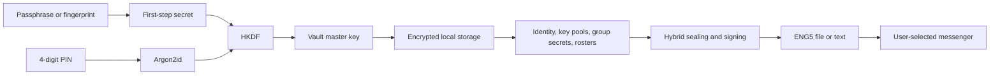

# Enigma system design

Version: 1.1.0 (versionCode 14), a development prototype release. Updated: 31 October 2026.

This is the living description of the implemented system. Update it with the code whenever its architecture, workflows, security or limitations change. Test evidence belongs in VERIFICATION.txt; threat details belong in SECURITY.md. Planned work is listed separately at the end. Earlier versions (0.3 to 0.6.0) used RSA identities, QKD3/file-v3 packets and QKJ1/QKG2/QKA1 joining; those were removed in 0.7.0 and are described only in the change log.

## Purpose and trust model

Enigma encrypts offline text and arbitrary files for selected members of an owner-managed group. An external messenger carries the encrypted packets. Enigma has no account service, delivery backend or VPN. It holds Android's INTERNET permission only for a temporary local joining socket over an app-started local-only hotspot or shared Wi-Fi; it makes no Internet requests.

Every installation has a hybrid device identity. Each group has an independent 32-byte secret. A device identity can participate in several groups. A message needs a recipient's one-time private keys (X25519 and ML-KEM-768) **and** the group secret to be read, and the sender's Ed25519 and ML-DSA-65 signatures to be accepted. The owner authenticates the member roster; trusting the owner delegates member introduction, not access to every recipient's private content. Names are owner-provided labels, not verified real-world identities. First pairing is performed directly between the owner's and joiner's phones.

Goals that must be kept: key generation uses OS randomness with live camera and motion input mixed in; only group members can decrypt a group's messages; every message is signed by its sender; only the selected recipients can read it; identity keys are exchanged only in person (nearby QR/NFC or manual file), never through a server or key directory. Non-goal: compatibility with OpenPGP or GnuPG.

## Components

| Component | Responsibility |
|---|---|
| MainActivity | Three-tab UI (Messages, Groups, Device), lock/PIN screens and the in-app number pad, guided joining, conversations, send/receive, in-memory viewer, external open/share workflows |
| Identity | Hybrid identity: Ed25519 + ML-DSA-65 signing keys, X25519 agreement key; `sign` makes both signatures, `verify` needs both |
| PostQuantum | ML-KEM-768 and ML-DSA-65 helpers over Bouncy Castle 1.86 (key seeds from Entropy) |
| PreKey / KeyPools | Backup and one-time keys (X25519 + ML-KEM-768, Ed25519-signed), per-contact pools, owner reserve, refill, deletion of removed people's keys |
| Entropy | Key-generation randomness: SecureRandom plus camera digests and motion-sensor readings through HKDF |
| SealedProtocol | ENG5 messages: one content key, per-recipient wrapping, signed inner header, refill keys and roster carrier |
| JoinProtocol | QKJ4/QKG4/QKA4: request, recipient-encrypted invitation, receipt, owner-signed roster |
| JoiningFlow | Fresh and resumed requests, bounded saved invitations, pending cleanup |
| JoinPhrase | EJP1 passphrase tag for remote joining files: normalisation, strength rule, PBKDF2 key, HMAC seal/open |
| JoinBootstrap | QKB1 single-QR/NFC packet, one-time KEK, transport key and check-code derivation, owner pinning |
| NearbyJoinDialog, JoinNfcService, LocalJoinWire, LocalJoinSession, SecureCaptureActivity | Foreground nearby joining: local-only hotspot or same Wi-Fi, QR display and scan, NFC, EJW1 frames, ordering and approval |
| Vault | Atomic encrypted storage of identity, pools, groups, rosters and history metadata; loaded secrets live only in an unlocked session |
| PasswordLock / PasswordCipher | Passphrase (Argon2id) envelope for the first-step secret; optional biometric envelope |
| PinBox / PinLock | PIN as part of the vault key, persisted attempt counter, panic PIN, crypto-erase wipe |
| Protocol, Packets | Shared crypto helpers and bounded binary framing |
| Inbox, MessageRecord | Conversation grouping, typed-message handling, in-app preview classification and the stored message record |
| Expiry | Signed expiry rules |
| QrImage | Native QR rendering with finder self-check and alternate mask selection |
| CameraActivity | Live camera input for key generation; no video or audio saved |



## Keys and algorithms

- **Identity:** Ed25519 + ML-DSA-65 signing keys and an X25519 agreement key, made on the phone from Entropy seeds and stored only in the passphrase vault (decision 7). Public size 2,016 bytes; private 96 bytes of seeds. Packets carry both signatures (64 + 3,309 bytes) and both must verify. The fingerprint is a SHA-256 of all three public keys.
- **Backup key:** X25519 + ML-KEM-768, signed with Ed25519, replaced every 30 days; the old private half is kept 365 days. Used when no one-time key is left (shown as "Reduced protection").
- **One-time keys:** X25519 + ML-KEM-768, signed with Ed25519, numbered, per contact (default 100), each used for exactly one message and deleted after that message is authenticated and decrypted. Refills travel inside messages (up to 10 per message).
- **Owner reserve:** 20 public one-time keys each member gives the owner on joining, so later members can message them at full protection from the first message.
- **Group secret:** 32 bytes per group from fresh OS randomness with the camera digest as extra salt input. It is the HKDF salt of every wrapping key.
- **Wrapping key per recipient:** HKDF-SHA-256 over four X25519 results (identity and backup/one-time keys with a fresh ephemeral key) and an ML-KEM-768 secret, salt = group secret, info "Enigma/PQX3DH/v1".
- **Content:** AES-256-GCM with a random 32-byte content key, fresh nonce and 128-bit tag.
- **Vault master key:** random 32 bytes. Vault format 3 encrypts with AES-256-GCM, fresh 12-byte nonce and AAD "Enigma-vault-v2".
- **Passphrase:** 12-128 characters. Argon2id v1.3 with 16-byte salt, 64 MiB, three iterations, four lanes (Bouncy Castle low-level implementation; no global provider). It protects a 32-byte first-step secret, and the device Keystore key quietkey.vault.v1 encrypts the envelope again (password.qkl).
- **PIN:** the master key is AES-GCM encrypted under HKDF(first-step secret, Argon2id(PIN)) (decision 12).
- **Optional biometric key:** a separate authentication-bound Keystore AES key (BIOMETRIC_STRONG via AndroidX BiometricPrompt and CryptoObject) that wraps the first-step secret. It replaces only the passphrase step.
- **Randomness:** Entropy mixes SecureRandom with camera digests and accelerometer/gyroscope readings through HKDF into an HMAC-DRBG; OS randomness is the foundation and the extras are not a measured guarantee (decision 10). The vault master key and the PIN salt use SecureRandom only.

Keys and plaintext exist in process memory during use. Byte arrays are cleared where practical, but Java cannot guarantee complete erasure. The device Keystore keys are not configured for per-operation authentication (except the biometric key); a compromised executing app could potentially use them.

## Locked-session workflow

On first use the user chooses and repeats a passphrase, a 4-digit PIN and a panic PIN (default 9999, must differ from the PIN), then names the device and completes camera setup (at least five seconds and 60 frames). The PIN fields use a number pad drawn by Enigma, with the phone keyboard suppressed for them, so no third-party keyboard sees the PIN.

Every unlock takes the passphrase or fingerprint, then the PIN. Before the second step no groups, history or group secrets are loaded. A wrong passphrase incurs a persistent increasing delay capped at 60 seconds (not a defence against offline guessing; Argon2id is).

PIN state lives in files/pin.qkp under the Keystore key: failure count, panic PIN, check value, salt, nonce and the encrypted master key. The count is written to disk before each PIN check, so closing the app does not reset it; a correct PIN resets it. Five wrong PINs, or the panic PIN, call `PinLock.wipe`: delete every Keystore alias first, then files, cache, shared preferences, databases and no-backup storage, then ask Android to clear application data. Android cannot uninstall an app, so an empty app remains. Wrong PINs count only after the first step succeeds. The PIN screen shows the attempts left; Security & unlock warns while the panic PIN is still 9999.

Installs from before the PIN are asked to set one, with the passphrase, before anything else; that re-wraps the passphrase envelope with a new first-step secret and turns biometric unlock off until it is enabled again. A vault from 0.6.0 (format 1) or an early 0.7.0 build (format 2) is detected and kept unchanged; Enigma shows "New keys needed" and only a passphrase-confirmed Start fresh replaces it.

Leaving Enigma locks it, clears visible data and queues disposal of loaded secrets; screen-off always locks. Camera setup and document pickers get a two-minute allowance, scanning the joining code five minutes, the Wi-Fi prompt 90 seconds. A generation counter rejects results from an obsolete session. Fresh passphrase entry is required before readable-file export, reset, passphrase change and biometric configuration; Change PIN also asks for it. There is no passphrase recovery.

## Joining: nearby (single QR or NFC tap, then Wi-Fi) and remote files

Joining is a separate layer from message encryption. It delivers one group's secret, settings, owner-signed roster and key supplies to one approved device. Message keys are derived per message and never reuse joining keys.

```mermaid
sequenceDiagram
  participant A as Group owner A
  participant B as Recipient B
  A->>A: Invite → Nearby; start local-only hotspot; bind listener; fresh 32-byte KEK
  A-->>B: QKB1 as one QR or NFC tap (SSID, passphrase, IP/port, KEK, owner fingerprint, expiry)
  B->>B: Join → Scan or tap; Wi-Fi network request; fresh signed QKJ4
  B->>A: QKJ4 in EJW1 frame (AES-GCM, key = HKDF(KEK))
  A->>A: Show check code = HKDF(KEK, SHA-256(QKJ4)); owner confirms codes match; persist grant
  A->>B: QKG4 encrypted only to B's X25519 + ML-KEM keys, owner-signed, group + roster + key supply
  B->>B: Verify; require owner == QKB1 fingerprint; show same check code; user confirms; commit
  B->>A: QKA4 signed receipt with key supply for A
  A->>A: Verify pending grant; persist Joined
  A->>B: Done
```

### Protection layers for the group secret

1. Wi-Fi WPA2/WPA3 of the temporary local-only hotspot or shared private Wi-Fi. Not relied on: the QR reveals the hotspot password and a spoofed access point is assumed.
2. One-time KEK from QKB1. HKDF-SHA-256(KEK, "Enigma/join-bootstrap/v1", "transport") keys every EJW1 frame (AES-256-GCM, fresh 12-byte nonce, header as AAD).
3. QKG4 recipient encryption and owner signature: X25519 (ephemeral and static) plus ML-KEM-768 to the joiner's backup key (info "Enigma/invite/v4"), AES-GCM over group ID, name, expiry, secret, roster and key supply, header binding the owner key, B's fingerprint, request ID and lifetime. Holding the KEK does not open it. B refuses any invitation whose owner fingerprint differs from QKB1.

QKJ4 carries B's public keys, name, a random 16-byte request ID, B's backup key and 20 reserve keys for the owner, and a signed lifetime of exactly five minutes (nearby) or seven days (remote files); any other lifetime is refused. QKG4 carries 100 one-time public keys for B; QKA4 carries 100 for the owner. Packet limits: request 64,000, invitation 600,000, receipt 200,000 characters, roster 256 KiB.

### Owner side

Groups → group → Invite new recipient offers, as app-styled buttons with one-line explanations: **Nearby: scan or tap** (recommended), **Nearby on the same Wi-Fi** and **By Signal or file: open their request**. Nearby asks for ACCESS_FINE_LOCATION+COARSE (API 26–32, maxSdkVersion 32) or NEARBY_WIFI_DEVICES with neverForLocation (33+) only when chosen, then NearbyJoinDialog calls WifiManager.startLocalOnlyHotspot. SSID/passphrase/security come from the reservation (SoftApConfiguration on 30+, WifiConfiguration before). The hotspot address is the private IPv4 that appears on a Wi-Fi/AP interface after start (polled up to six seconds; falls back to an address ending .1). Same-Wi-Fi mode uses the current Wi-Fi network's link address. A ServerSocket binds to that address only on port 45873 (ephemeral if busy) before QKB1 is built with the bound port.

QKB1 ("bootstrap-v1", about 250 characters) contains mode, SSID, passphrase, security type, IPv4, port, KEK, owner fingerprint and expiry (five minutes). It is rendered as one QR (QrImage self-checked mask) and published to JoinNfcService. On Android 15+ the owner also calls NfcAdapter.setDiscoveryTechnology(FLAG_READER_DISABLE, FLAG_LISTEN_KEEP) while the code is shown (reset on every exit), so its own NFC poller cannot read the recipient phone and open Android's "Empty tag" screen, which would background and lock Enigma. The listener allows at most five failed initial connections with ten-second reads, accepts one verified request, clears the NFC payload, shows the check code in the Invite consent dialog and proceeds only on **Codes match · Invite**. JoiningFlow.invite persists the Invited grant before sending QKG4. The hotspot reservation, listener and KEK are released on success, Cancel, failure, lock or the five-minute deadline.

### Recipient side

Groups → Join group offers **Nearby: scan or tap** (recommended), **By Signal or file: make my request** and **By Signal or file: open the invitation**; the nearby screen's button is **Scan QR code**, matching the owner's on-screen instructions. Nearby creates a fresh signed QKJ4, then accepts QKB1 from the ZXing ScanContract (SecureCaptureActivity, FLAG_SECURE, five-minute handoff) or from NFC reader mode (IsoDep select of AID F0454E49474D4101, then chunked reads). Android disables reader mode whenever the activity pauses (for example the QR scanner); MainActivity.onResume re-arms it while the recipient is still waiting, otherwise the phone would read the owner as an "Empty tag" (fixed in 0.6.0 after phone testing). After parsing it shows the check code. Hotspot mode on API 29+ uses WifiNetworkSpecifier + ConnectivityManager.requestNetwork (no Internet capability, 60-second timeout, 90-second handoff for the system prompt); API 26–28 shows the SSID/passphrase for manual connection. Same-Wi-Fi mode uses the current Wi-Fi network. The socket is bound to that Network and connects to the QKB1 address, then the network's private gateway. LocalJoinSession runs request → invitation → receipt → done. The accept callback verifies QKG4, requires the QKB1 owner, then shows the check code and owner fingerprint for **Join group**.

### Shared rules

B checks its active request, intended fingerprint, signatures, lifetime, GCM, owner-signed roster and membership before committing trust; all member public keys import together and duplicate groups are refused. Consumed joining IDs are retained separately from groups. The owner shows Invited until QKA4 (nearby) or B's first verified message, which also clears B's cached invitation. The receipt cannot grant membership.

The encrypted vault retains at most 64 pending invitation records (exact request, group, member, ciphertext, expiry and roster revision). A consumed request may resume only its still-pending exact grant with the member present and unblocked; an unchanged roster returns identical ciphertext. Removing a member or group, or a fresh request, cancels cached grants while the used-ID ledger (maximum 10,000) is kept. A stale receipt cannot confirm a replacement grant.

LocalJoinWire EJW1 uses a 4-byte magic, 1-byte mode, 1-byte type, 4-byte per-direction sequence and 4-byte length. Payload limits follow the packet limits above; Done is exactly "Joined". Encrypted bodies add a 12-byte nonce and 16-byte tag. Ordering, direction, type, sequence, downgrade and size are enforced. Cancel, lock, background or destruction closes transport and cancels approvals. No background listener is installed except the NFC host card emulation service, which serves nothing unless an invite screen is open.

### Remote joining by file (Signal, email, USB)

Implemented in 1.1.0, replacing the 1.0.0 manual transfer (five-minute request, live check-code comparison, confirmation file).

```mermaid
sequenceDiagram
  participant B as Joining phone
  participant A as Owner phone
  Note over A,B: Agree a passphrase by voice (4+ words)
  B->>B: QKJ4 request, 7-day lifetime; K = PBKDF2(phrase, SHA-256(domain || QKJ4)); store K in vault
  B->>A: EJP1 tag(K,"request") . QKJ4 (share sheet: Signal, email, USB)
  A->>A: Type phrase; derive K from received QKJ4; refuse unless tag matches; Invite
  A->>B: EJP1 tag(K,"invitation") . QKG4 (encrypted to B, owner-signed)
  B->>B: Refuse unless tag matches stored K; verify QKG4; Join
  B->>A: First ENG5 message: owner marks B Joined
```

1. B: **Join group → By Signal or file: make my request** asks for the passphrase (JoinPhrase.requireStrong: at least 4 words and 16 characters after normalisation, which lower-cases and folds spaces, dashes, underscores, dots and commas). It makes a fresh QKJ4 with JoinProtocol.FILE_WINDOW (seven days), derives K (PBKDF2-HMAC-SHA-256, 310,000 iterations, 256-bit, salt SHA-256("Enigma/join-phrase/v1" || request)), stores the request in Vault.joiningRequest and K in Vault.joiningKey, and offers **Share** (FileProvider `enigma-join-request.enigma`, application/octet-stream) or **Save file**.
2. A: opening the file from another app (ACTION_VIEW/SEND, handled after unlock; receiveFile routes files that start with `EJP1:`) or through **By Signal or file: open their request** asks which owned group (if more than one) and for the passphrase, verifies the tag with MessageDigest.isEqual, shows the device name and fingerprint, and on **Invite** runs JoiningFlow.invite unchanged, then tags QKG4 with the label "invitation" and shares `enigma-invitation.enigma`.
3. B: opening the invitation verifies the tag with the stored K, then JoinProtocol.accept (unchanged checks), shows the owner fingerprint and member count, and commits on **Join**; commitJoin clears joiningRequest and joiningKey and records the request ID as used.
4. B's first verified message marks B Joined on A and cancels the cached grant. There is no confirmation file. Nearby joining is unchanged (five minutes, check codes, QKA4 over the local link).

### Group membership and roster updates

Every message carries the owner-signed roster and its revision in an encrypted carrier. Receivers adopt a higher revision after the packet is authenticated, so a member who joined later is learned about as soon as any message carrying the newer roster arrives. When C joins after B, the owner's roster passes C a reserve key of B's and B one of C's, so B and C message each other at full protection from the first message. Only the owner admits and removes members. Removing or blocking a member (or deleting a group, or adopting a roster that drops someone) deletes the keys shared with every person who is no longer a trusted member of any group on the device (`KeyPools.forgetAllExcept`), including this device's unused one-time private keys issued to them.

## Messages: ENG5 sealing and opening

**Sending.** The user chooses a message or file, a group and one or more recipients (up to 50), with optional expiry and View once.
1. The content is encrypted once with a random content key (AES-256-GCM).
2. For each recipient, take an unused one-time key from that recipient's pool for this sender (or their backup key), make a fresh ephemeral X25519 key, run the X3DH steps, encapsulate an ML-KEM-768 secret to the same key, derive the wrapping key with HKDF using the group secret as salt, and wrap the content key.
3. The outer header carries opaque key IDs, ephemeral public keys and ML-KEM ciphertexts (1,088 bytes each), not fingerprints. Each recipient finds its entry by its own key IDs.
4. Inside the encryption: the signed inner header (group, roster revision, sender, message ID, every recipient and key ID, content hash, expiry, view-once flag, name and type), the Ed25519 + ML-DSA-65 signature, fresh signed one-time keys for each recipient (the refill), the sender's current backup key and the roster carrier.
5. Ephemeral private keys are deleted at once. The sender's plaintext copy is stored in the vault history (not for view-once).

Because the signature covers the full recipient list and sits inside the encryption, a recipient cannot re-wrap a signed message for someone else and have it accepted as addressed to them (surreptitious forwarding). Every recipient sees the recipient list, like an email "To:" line.

**Receiving.** Find the entry addressed to this device's key IDs, recompute the wrapping key and unwrap, decrypt, verify both signatures, check the device is in the signed recipient list and the group and roster revision match. Only then: delete the one-time private key, store the plaintext in the vault, verify and store the refill keys, and adopt a newer roster. A replay of a one-time-key message fails because the key is gone; backup-key messages use the replay log. Entries arrive in any order. A file that cannot be parsed shows one plain explanation (older format, other keys, damaged) and opens nothing.

**Empty pool.** The sender uses the recipient's backup key; both phones show "Reduced protection" on that message until a refill arrives.

**Limits.** Content up to 50 MiB held in memory (no chunked streaming yet); outer header 256 KiB, inner 2 MiB, per-entry 4,096 bytes; `ENG5:` text uses the same packet in base64 and whitespace is stripped on paste.

## The app

- **Tabs:** Messages (default), Groups, Device. Messages lists conversations built by Inbox from encrypted history: one per (group, other member), newest first, items as bubbles. Send and Receive appear at the top of Messages and inside each conversation.
- **Send:** (1) type a message or choose a file (ACTION_OPEN_DOCUMENT, 50 MiB check), (2) group, (3) recipients, optional expiry and View once, then **Encrypt & share**. The package is verified, stored and offered through the share sheet. **Send as text instead** produces `ENG5:` text. Sending from a conversation preselects its group and person.
- **Receive:** **Open .enigma file**, pasted text, or Android ACTION_VIEW/ACTION_SEND into Enigma (`content://` only, never Enigma's own FileProvider), only after unlock. Group routing reads the unauthenticated group ID from the packet only to choose the local group to verify against.
- **Viewer:** after full verification and a durable commit, images (JPEG/PNG/WebP/GIF/BMP/HEIC up to 25 MiB, decoded subsampled to 2,048 px) and text (up to 1 MiB) are restored into a pre-sized in-memory buffer zeroed after decoding; other types show name and size. **Save to device** needs the passphrase and writes a readable copy outside Enigma. Outgoing items offer Share again and Save .enigma file (for USB).
- **Device:** setup status and name, version, guide, fingerprint, rename, reset. **Security & unlock** has Lock now, passphrase change, **Change PIN or panic PIN**, biometric setting.
- **Groups:** create and join, a compact list, group details with Invite, members, send, rename, remove.

## Storage

- **groups.qkv:** vault format 3 under AES-256-GCM: identity, key pools, group secrets, rosters, aliases and blocks, replay logs (bounded at 100,000 per group), joining state and message metadata.
- **password.qkl:** the passphrase and device-key envelope for the first-step secret. **pin.qkp:** PIN state under the device key. **biometric.qkb:** optional biometric envelope.
- **files/history:** opened content, each file AES-GCM encrypted under a key derived from the master key and the file name. View-once content is never stored. **files/packages:** outgoing packages for Share again, with opaque UUID names.
- History keeps 200 items and up to 150 MiB of encrypted files; pruning follows a successful vault commit. Files shared via FileProvider are ciphertext from a non-exported cache path, cleaned after 24 hours. Backups are disabled.

## Expiry, removal, reset and limits

Message expiry defaults to none; choices are five minutes, one hour, 24 hours, seven days and 30 days, clamped to the group's ten-year local expiry. The signed timestamp is checked on opening, reopening and saving. Device clocks, modified clients and saved plaintext are outside this policy; View once likewise cannot stop another camera.

Removal blocks local use of the identity and deletes the keys held for it (see Group membership) but does not erase a secret from that person's phone. For revocation, create a fresh group and invite only remaining members. Reset requires the passphrase and the exact typed RESET; Android clears the app's data and the empty app remains. Forgotten-passphrase reset through Android Settings is destructive, not recovery.

Limits that remain:
- The design and code are not independently audited. Enigma's own combinations need particular test coverage.
- Forward secrecy depends on deleting keys. Flash storage and Java memory cannot guarantee erasure. Backup-key messages have weaker forward secrecy until the backup key is replaced.
- No post-compromise recovery: a thief who unlocks the phone can impersonate its owner until the owner is told and the member rejoins.
- Stored history is exactly as safe as the vault unlock (passphrase or fingerprint, plus PIN).
- The hybrid algorithms protect against one algorithm family failing. They do not protect against bugs in Enigma, Bouncy Castle or Android, or a compromised phone.
- Someone who controls the phone at root level and also has the passphrase or a fingerprint can bypass the wrong-PIN count: root can use (not extract) the device Keystore key to read pin.qkp and then try all 10,000 PINs, each costing one Argon2id run. Without the first step this is not possible.
- Backup and one-time keys carry an Ed25519 signature only, to keep key pools small (an ML-DSA signature would add 3,309 bytes per key). They only travel inside packets with a hybrid signature or inside the owner-signed roster. A group owner who could also forge Ed25519 could swap another member's keys in a roster; that needs an insider and a broken Ed25519, and reading messages would still need X25519 or ML-KEM to fail as well.
- INTERNET permission is held for the local joining socket; Android has no permission limited to the local network. Messages never use the network.
- AES-256-GCM is the only content cipher; it is not considered at risk from quantum computers, so no second symmetric layer was added.
- The external messenger sees who sends files to whom, when and how large. A trusted, malicious or compromised owner can introduce deceptive names or devices. The app cannot prevent a recipient forwarding plaintext, a message being sent to the wrong contact, external cameras, malicious keyboards or a compromised OS.

## Decisions (agreed with the owner, 29 October 2026)

1. **Owner loss**: the owner may name a second admin, who can also send signed group updates. Without one, a lost owner phone means rebuilding the group in person.
2. **Removal**: removing a member also replaces the group secret. The new secret travels inside the signed update to each remaining member.
3. **Own compromise**: the member tells the owner, who sends an update marking the old identity revoked. The member then rejoins in person with new keys.
4. **Multiple recipients**: every recipient sees the signed recipient list, like an email "To:" line.
5. **Camera reseeding**: whenever the camera is already in use, for example when joining. There is no extra prompt.
10. **Motion sensors as a second extra source**: the generator also mixes in accelerometer and gyroscope readings (values plus timing) gathered while Enigma is open and unlocked. These sensors need no Android permission, and they still contribute when the camera is broken, covered or dark. The microphone was considered and rejected: it adds little beyond the camera and would need audio-recording permission. As with the camera, OS randomness remains the security foundation; sensor input is not a measured entropy guarantee.
6. **Format change**: all members rejoin in person for 0.7.0.
7. **Key storage**: vault only (owner's choice, 29 October). The Keystore generates keys internally, so camera and motion randomness could not be mixed into them.
8. **Defaults**: 100 one-time keys per contact, 20 owner-reserve keys per member, up to 10 refill keys per message, and a new backup key every 30 days.
9. **Empty pool**: send using the backup key with a "reduced protection" mark rather than refuse.
11. **Two algorithm families** (30 October 2026): to guard against a break in one algorithm, every key agreement combines X25519 with ML-KEM-768 (FIPS 203) and every packet signature combines Ed25519 with ML-DSA-65 (FIPS 204). Reading a message needs both agreement algorithms broken (and the group secret); forging one needs both signature algorithms broken. RSA was considered and rejected: it fails to the same quantum attack as X25519 and its key generation is too slow for one-time key pools. Costs: an ML-KEM public key is 1,184 bytes, each recipient entry gains 1,088 bytes, each signature is 3,373 bytes and each identity 2,016 bytes. Packet limits were raised to match.
12. **Two-step unlock with wipe** (30 October 2026): passphrase or biometrics, then a 4-digit PIN. Five wrong PINs, or the panic PIN (default 9999, changeable), erase Enigma's keys and data. The PIN is part of the vault key, so a copied file cannot be PIN-guessed without the first step.
13. **Remote joining by passphrase** (31 October 2026, owner request): joining by file uses a passphrase agreed by voice instead of a live check code, a seven-day request instead of five minutes, the share sheet instead of save-and-copy, and no confirmation file. "Never expire" was not adopted: a request works once, and seven days keeps an old file in a chat harmless.

## Verification and future work

Executed build and test evidence is recorded in VERIFICATION.txt, not inferred from this design. Automated checks cover the pure-Java protocol classes (73 JVM tests at 1.1.0) and emulator PIN, vault and screenshot tests; physical-phone joining, messaging and the panic PIN were checked by the owner on two phones with the 0.7.0 build, and the 1.0.0 number pad has been checked on an emulator. Remaining manual checks are listed in TESTING.md.

Planned work, not implemented: reserve replenishment; an explicit "Send group update" button; a second admin who can sign updates; replacing the group secret when a member is removed (decisions 1-3); chunked streaming for large files; a dedicated personal file vault or recovery design if requested; accessibility and device-size coverage; an independent security audit. These are not claims about the current build.

## Change log

- 1.1.0 / 31 October 2026: remote joining by file (Signal or any app). Request and invitation carry an EJP1 HMAC tag keyed by PBKDF2 of a passphrase agreed by voice; remote requests last seven days (nearby stays five minutes); files are shared through the share sheet and open from other apps; the confirmation file is gone (first message confirms). New JoinPhrase class and Vault.joiningKey; QKJ4/QKG4 formats unchanged apart from the accepted lifetime.
- 1.0.0 / 30 October 2026 (documentation): SYSTEM_DESIGN.md and SECURITY.md rewritten to describe only the 1.0.0 design; the 0.6.0 RSA, QKD3/file-v3 and QKJ1/QKG2/QKA1 sections were removed (they remain in git history).
- 1.0.0 / 30 October 2026: first release version after phone testing of 0.7.0 (joining between two phones, JPEG sending, panic PIN, old-format file refused). PIN entry uses an in-app number pad; files that cannot be parsed (older format, other keys, damaged) show one plain explanation instead of "Invalid packet size". No protocol or storage change.
- 0.7.0 / 30 October 2026 (branch, security review): removed or blocked members' keys are now deleted when they are no longer in any group on the device; prekey signature, root PIN-guessing, INTERNET permission and vault-key randomness limits documented.
- 0.7.0 / 30 October 2026 (branch): hybrid algorithms (X25519 + ML-KEM-768, Ed25519 + ML-DSA-65; ENG5, QKJ4/QKG4/QKA4, vault format 3) and two-step unlock (passphrase or biometrics, then a PIN; wipe after 5 wrong PINs or on the panic PIN).
- 0.7.0 / 29 October 2026 (branch): Ed25519/X25519 identities in the vault, camera and motion entropy, X3DH one-time keys with per-contact pools and owner introductions, multiple recipients, view once, readable history stored encrypted in the vault, 0.6.0 vault upgrade screen; RSA formats removed.
- Proposal / 29 October 2026: 0.7.0 message-security design recorded for owner sign-off (X25519/Ed25519, X3DH-style one-time keys with per-contact pools and owner reserve, multiple recipients, plaintext history in the vault, explicit owner group updates). Not implemented; the build remains 0.6.0.
- 0.6.0 / 28 October 2026: NFC joining fix (recipient reader mode re-armed after the QR scanner or any pause; owner polling disabled on Android 15+ while serving) after "Empty tag" was seen in phone testing; joining menus rebuilt as buttons whose names match the on-screen instructions; messenger-style Messages tab with conversations, Send (message or file → group → person) and Receive; typed messages sent as .enigma files by default with text packets as the alternative; received photos/text open in an in-memory viewer with Save to device as a separate step; Enigma accepts .enigma files and text opened or shared from other apps; Home tab removed.

- 0.5.0 / 28 October 2026: received text/files open in the group named by the packet and tolerate messenger line-wrapping (fixes "message did not decrypt" when another group was selected); nearby joining by one QR code or NFC tap over an app-started local-only hotspot or same Wi-Fi with a one-time KEK, owner-fingerprint pinning and six-digit check codes; manual file transfer for USB cables/any copy with a check code; USB accessory, typed hotspot code and multi-frame QR joining removed; CameraX dependency removed.

- 0.4.4 / 6 October 2026: USB-first joining, personal-hotspot alternative, QR deferred to fallback; AOA host/accessory adapter, temporary-code authenticated local frames, two-sided consent and automatic signed confirmation; foreground transport lifecycle and updated device guide.

- 0.4.3 / 5 October 2026: restore release 1 standard scanner/autofocus defaults; remove automatic camera switching and QR cycling; fixed square full-screen QR/camera areas with scrollable text; manual per-code success/continuation, explicit swap and completion screens; rendered-pixel/layout regressions at small screens and enlarged text.

- 0.4.2 / 5 October 2026: two offline camera paths with automatic/manual fallback and stride-aware CameraX decoding; smaller frames, verified QR masks and missing-frame progress; numbered joining instructions, paste transport, simple success and explicit fresh restart; persisted pending invitation resumption and removal cleanup with retained replay protection.

- 0.4.1 / 4 October 2026: AndroidX cryptographic biometric prompt and post-authentication GCM handling; API26-compatible joining calls; unified continuous scanner with full preview/focus/light/progress; smaller full-screen cycling QR frames; visibility toggles for password entry; compact Home/Groups/Device and updated guide. Message cryptography and recipient requirements remain unchanged.
- 0.4 / 4 October 2026: guided recipient-specific joining, signed directory transport, cycling QR collection, passphrase-encrypted local storage, optional biometric envelope, session locking/fresh authentication, corrected group/endpoint key derivation; living design and repository maintenance instructions added.
- 0.3: four tabs, mandatory recipient selection, encrypted unified history, message TTL and reset.

References: [Android Keystore](https://developer.android.com/privacy-and-security/keystore), [cryptographic biometric authentication](https://developer.android.com/identity/sign-in/biometric-auth), [Argon2, RFC 9106](https://www.rfc-editor.org/rfc/rfc9106.html), [HKDF, RFC 5869](https://www.rfc-editor.org/rfc/rfc5869), [local-authentication weakness, OWASP](https://mas.owasp.org/MASWE/MASVS-AUTH/MASWE-0020/).
