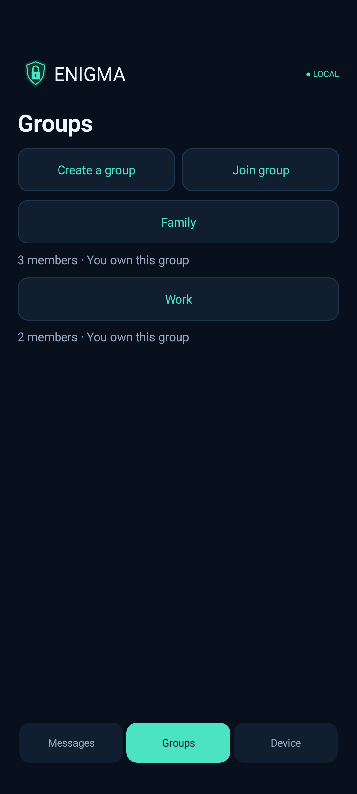
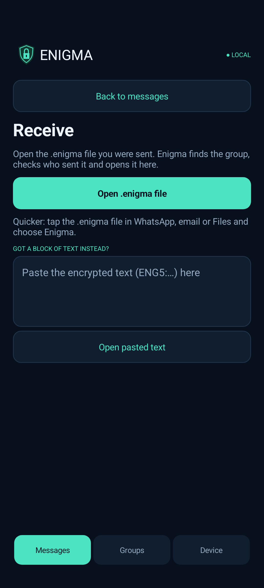
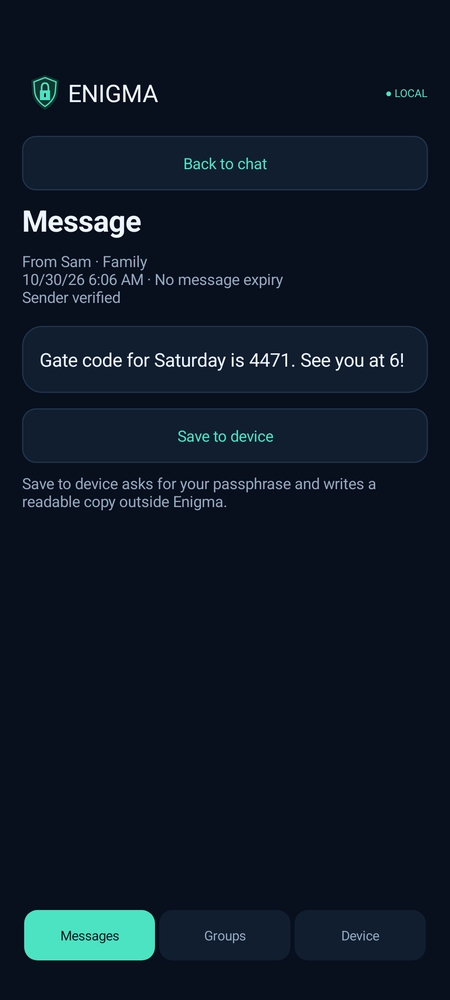

# Enigma user guide

Version 1.0.0. Enigma is an Android app for sending encrypted messages, photos and files through any app you already use (WhatsApp, email, a USB stick). Keys are made on your phone and swapped in person. There is no server and no account.

> **This is a development prototype.** It has not had an independent security audit. Use it for things you would be comfortable testing with, and keep a second way to reach people. There is no password recovery: if you forget your passphrase, your data is gone.

Screenshots in this guide come from the app's test build with demo data only.

## Contents

1. [What you need](#1-what-you-need)
2. [Install](#2-install)
3. [First start: passphrase, PIN and camera](#3-first-start-passphrase-pin-and-camera)
4. [Join a group in person](#4-join-a-group-in-person)
5. [Send a message, photo or file](#5-send-a-message-photo-or-file)
6. [Receive and open](#6-receive-and-open)
7. [Locking, PIN and panic PIN](#7-locking-pin-and-panic-pin)
8. [How the security works](#8-how-the-security-works)
9. [What Enigma does not protect against](#9-what-enigma-does-not-protect-against)
10. [Troubleshooting](#10-troubleshooting)

## 1. What you need

- Two or more Android phones, Android 8 or newer. Everyone in a group needs Enigma.
- To be in the same room once, to join. Joining is how Enigma knows who to trust.
- A way to pass a small file or block of text between phones afterwards: any messaging app, email or a cable.

## 2. Install

1. On each phone, open **https://github.com/Tersy89/QuietKey**, choose `Enigma.apk`, then **Download raw**.
2. Open the file and allow installing from this source if Android asks. The app appears as **Enigma (test)**.
3. Android may warn that the app is unknown. It is a test build signed with a debug key, not a Play Store app.

Installing a newer `Enigma.apk` over the old one keeps your data.

## 3. First start: passphrase, PIN and camera

1. **Passphrase.** Choose one of 12 to 128 characters and repeat it. Several random words work well. Tap **Show passphrase** to check your typing.
2. **PIN.** Choose a 4-digit PIN and repeat it. You type it on Enigma's own number pad, so the phone keyboard (and any third-party keyboard) never sees it.
3. **Panic PIN.** This starts as `9999`. Change it to something only you know. It cannot be the same as your PIN. Entering it instead of your PIN erases Enigma at once (section 7).
4. **Camera.** Name your device, then move the camera around for about five seconds. The app digests the frames to add randomness to your keys. No video or audio is saved.

From now on, opening Enigma takes two steps: your passphrase **or** fingerprint, then your PIN. You can turn on fingerprint unlock in **Device → Security & unlock**.

## 4. Join a group in person

Only the owner creates a group. The owner is the person who made it, and only they can invite people.

**Owner:** **Groups → Create a group**, then open the group and tap **Invite new recipient → Nearby: scan or tap**. Allow the permission Android asks for the first time. Enigma starts its own private hotspot (no Internet is used) and shows a QR code.

**Joining person:** **Groups → Join group → Nearby: scan or tap**, then scan the QR code. Or hold the phones back to back with NFC on until the check code appears. Tap **Connect** if Android asks.

**Check the code.** Both screens show the same six-digit code. Look at each other's screens. Only if the codes match, the owner taps **Codes match · Invite** and the joiner confirms. If the codes differ, tap Cancel: someone else may be in the middle.

Things to know:

- The QR code works once and expires after five minutes. Show it only to the person joining.
- Keep both apps open until it finishes. Backgrounding or locking either phone stops the join.
- A group holds up to 30 devices. Repeat the joining for each person.
- No Wi-Fi network in common? Enigma makes its own hotspot. Already on the same private Wi-Fi? The owner can choose **Nearby on the same Wi-Fi**.
- **No QR or NFC?** Use **By file** on both phones: the joiner saves a request file, the owner opens it and saves an invitation file, and the joiner opens that. Copy the files by any route, for example over USB. Compare the six-digit code in person or on a call.

When someone joins later, the owner's phone signs an updated member list that travels inside their next messages. Existing members learn about the new person automatically.

## 5. Send a message, photo or file

1. Go to **Messages → Send**.
2. Type a message, or choose a file or photo.
3. Choose the **group**, then tick the **people** (one or several) who should be able to read it.
4. Optional: set an **expiry** (the message stops opening after that time) or **View once** (it is not kept after it is read).
5. Tap **Encrypt & share**, then pick WhatsApp, email or any other app.

Enigma makes a small `.enigma` file that only the chosen people can open. Alternatives:

- **Send as text instead** produces a block of text starting with `ENG5:` that you can paste into any chat.
- Open the sent item later and choose **Save .enigma file (for USB)** to copy it across by cable.

"Sent" means encrypted by Enigma. Enigma cannot see whether the other app delivered it.

## 6. Receive and open

- Tap the `.enigma` file in WhatsApp, email or Files and choose **Enigma**, or use **Messages → Receive → Open .enigma file**.
- For text, copy the whole `ENG5:` block and use **Messages → Receive → Open pasted text**.

Enigma works out the group, checks the sender's signature and opens the message. Photos and text are shown inside the app. Other files show their name and size.

**Save to device** asks for your passphrase and writes a readable copy outside Enigma, where other apps can see it.

Your conversations are listed under **Messages**, one per person per group, newest first. Sent items are on the right, received on the left.

If the same file is opened a second time, Enigma shows the stored copy. The key that opened it was used once and is already deleted.

## 7. Locking, PIN and panic PIN

- Enigma locks when you leave the app and when the screen turns off. **Device → Lock Enigma now** locks it on demand.
- Unlocking needs your passphrase or fingerprint, then your PIN.
- After **5 wrong PINs**, or if you enter the **panic PIN**, Enigma erases its keys and data, and the app restarts empty. The remaining attempts are shown on the PIN screen. Closing the app does not reset the count.
- The panic PIN is `9999` until you change it. Change it in **Device → Security & unlock → Change PIN or panic PIN**. The app warns you while it is still `9999`.
- The wrong-PIN count only starts after your passphrase or fingerprint succeeds, so a stranger cannot erase your data without it.
- Android does not let an app uninstall itself. Erasing destroys the keys and files and leaves the empty app.

**Tell the people in your group** if you lose a phone or erase Enigma. The owner can remove a device from the group (**Manage members**), and the phone's keys for them are deleted.

## 8. How the security works

This section summarises the design. The full detail is in [SYSTEM_DESIGN.md](../SYSTEM_DESIGN.md) and [SECURITY.md](../SECURITY.md).

### Five layers

| Layer | What it does |
| --- | --- |
| **Unlock** | Passphrase or fingerprint, then a 4-digit PIN. 5 wrong PINs or the panic PIN erase everything. Protects the phone at rest. |
| **Vault** | Identity keys, key pools, group secrets and opened history are encrypted with AES-256-GCM under the vault master key. |
| **Joining in person** | QR code or NFC tap, matching check codes, and an owner-signed invitation encrypted only to the joining phone. Decides who is trusted. |
| **Group secret** | A 32-byte secret shared only by members and mixed into every message key. Outsiders cannot derive any key. |
| **Per-recipient message key** | A one-time key, used once and deleted. X25519 plus ML-KEM-768 together, signed with Ed25519 plus ML-DSA-65. |

### Two families of cryptography at once

Every key and signature has two halves from two unrelated kinds of mathematics:

- **Key agreement:** X25519 (classic) and ML-KEM-768 (post-quantum). Both must hold to read a message.
- **Signatures:** Ed25519 (classic) and ML-DSA-65 (post-quantum). Both must verify or the packet is rejected.

If a flaw or a quantum computer breaks one family, the other still protects the message. The post-quantum algorithms are newer, which is why they are paired with the proven ones rather than used alone.

### Forward secrecy: every message has its own key

- Each message to you uses one of your one-time keys. Its private half is deleted after the message is opened.
- If someone records your messages now and steals your phone later, the keys those messages needed no longer exist.
- Key pools refill automatically: each message carries ten fresh one-time keys back to the other person.
- If a pool is ever empty, the sender uses your longer-lived backup key. Both phones then show **Reduced protection** on that message.

### Where the keys come from

Android's secure random generator is the foundation. Enigma adds a digest of the live camera frames from setup, plus accelerometer and gyroscope readings gathered while the app is unlocked, and mixes them in with HKDF-SHA-256. The extras can only add unpredictability. They are a bonus, not a measured guarantee.

### What a sealed message contains

One message is encrypted once with AES-256-GCM. For each recipient (up to 50), that content key is locked under a key only that person can rebuild from four X25519 steps, one ML-KEM step and the group secret. The signed header lists the group, sender, every recipient, a hash of the content and the member list. Because the recipient list is signed and encrypted, nobody can re-wrap your message for someone else and make it look addressed to them. A group member who was not chosen sees "not addressed to you".

### Joining is separate from messaging

The QR code carries a one-time connection key that only protects the short local link. It never stands in for the invitation, which is separately encrypted to the joining phone's own keys. Someone who photographs your QR code still cannot read the invitation. The six-digit check code is what lets two people confirm they are talking to each other.

### The PIN is part of the key

The PIN is not a lock the app checks. It is mixed into the key that opens the vault, stretched with Argon2id. The first step's secret is held by the phone's hardware-backed keystore, so a copied vault file cannot be PIN-guessed on a computer. The attempt counter is written to storage before each PIN is checked, so force-closing the app cannot buy extra tries. On the fifth failure or the panic PIN, Enigma deletes the keystore keys first and then the files.

### What an attacker gets

| Scenario | Result |
| --- | --- |
| Intercepts a `.enigma` file in a messenger | Nothing readable. They need a recipient's one-time private key and the group secret. |
| Breaks X25519 or Ed25519 | Still protected: ML-KEM and ML-DSA must be broken too. |
| Finds a flaw in ML-KEM or ML-DSA | Still protected: X25519 and Ed25519 still hold. |
| Group member who was not a recipient | Nothing readable. They know the group secret but not the one-time keys. |
| Records messages now, steals your phone later | Messages you have not opened cannot be read: their one-time keys are protected by the lock. Messages you already opened are in your encrypted history, which only opens with your passphrase or fingerprint and PIN. |
| Steals your locked phone | Needs your passphrase or fingerprint and then the PIN. Five wrong PINs erase it. |
| Photographs your joining QR code | Cannot read the invitation, which is encrypted to the joining phone only. |

## 9. What Enigma does not protect against

- **A compromised phone.** Malware, a rooted phone under someone's control, or someone watching while you are unlocked can see what you see. A person with root access who also has your passphrase or fingerprint could try all 10,000 PINs.
- **Who you are talking to.** Enigma proves that a key belongs to the person you met and compared check codes with. It does not prove a real-world identity beyond that.
- **Metadata.** The app you use to send the file (WhatsApp, email) still knows who sent a file to whom and when.
- **Copies you make yourself.** **Save to device** writes a readable copy outside Enigma. Expiry stops Enigma opening a message but cannot delete a copy someone already saved.
- **Screenshots and photos of the screen** by the person you sent a message to. Enigma blocks screenshots in its own windows, but a second phone camera cannot be stopped.
- **Lost passphrase.** There is no recovery.
- **No independent audit.** The design and code have been reviewed by the project's authors only. The tests that were run are recorded in [VERIFICATION.txt](../VERIFICATION.txt).
- **Group-owner trust.** The owner signs the member list. A malicious owner is not defended against by this prototype.

## 10. Troubleshooting

**"This is not an Enigma message this version can open."** The file may be from an older Enigma version, made for different keys or another group, or damaged. Ask the sender to send it again after you have both joined the same group on the current version.

**"Reduced protection" on a message.** The sender had run out of your one-time keys and used your backup key. It is still encrypted. Messages going back and forth refill the pools.

**Joining says it failed or shows different check codes.** Cancel on both phones and start again. Different codes mean something else is in the middle, so do not continue.

**NFC does not start.** Make sure NFC is on for both phones, hold them back to back and keep both screens on. Use the QR code instead if needed.

**The phone keyboard appears for the PIN.** The PIN fields use Enigma's own number pad. If you see the system keyboard you are probably in the passphrase field.

**Forgot the passphrase.** There is no bypass. Android Settings can clear the app's data, which permanently loses the local keys and data. You then set up again and rejoin your groups in person.

**Reset.** **Device → Reset app & delete local data** removes everything on this phone after you confirm.
